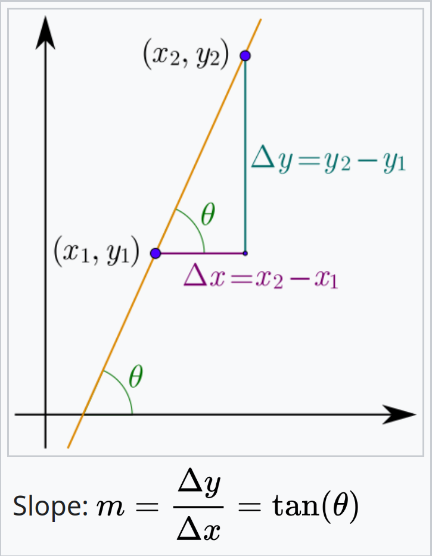
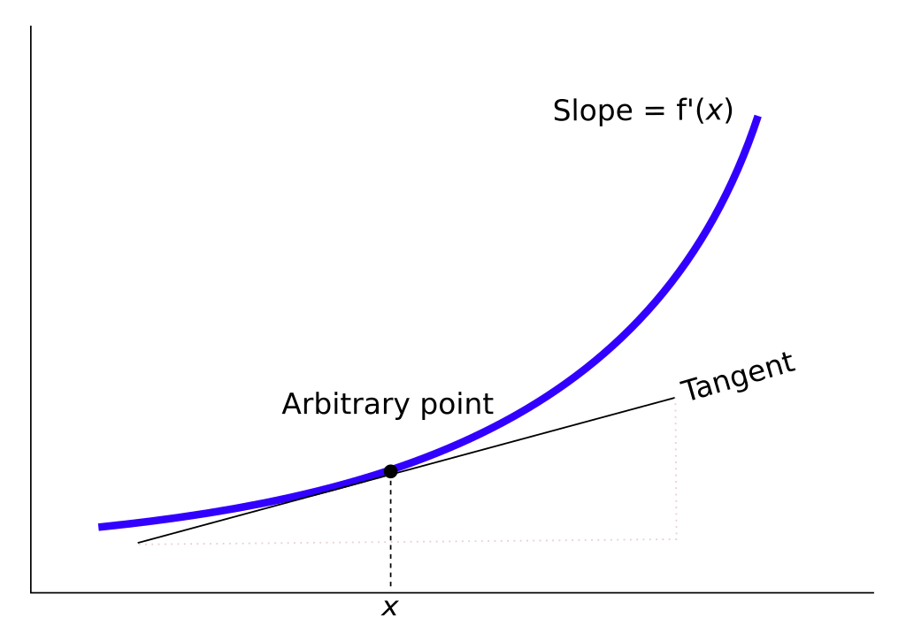
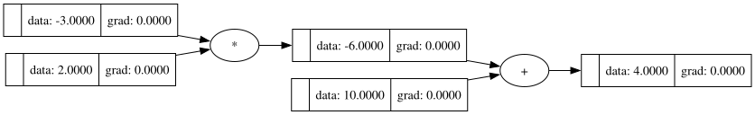
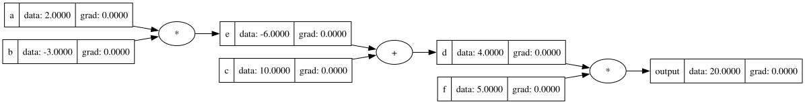
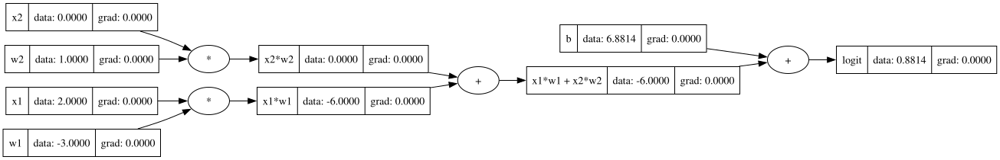
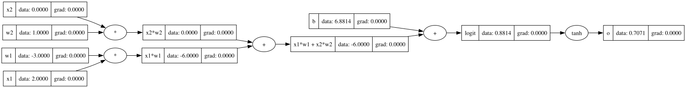
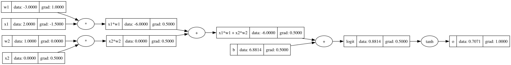
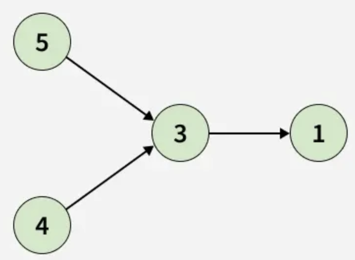
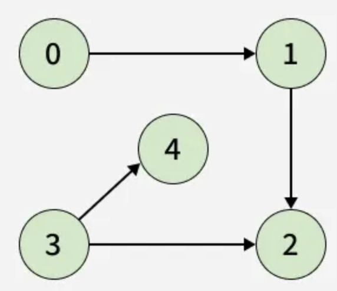

# Introduction to Deep Learning

- [Introduction to Deep Learning](#introduction-to-deep-learning)
  - [Week 01 - Introduction to NumPy, Matplotlib and PyTorch](#week-01---introduction-to-numpy-matplotlib-and-pytorch)
    - [Administrative - week 1](#administrative---week-1)
    - [Creating the task runway](#creating-the-task-runway)
      - [Task 01](#task-01)
      - [Task 02](#task-02)
      - [Task 03](#task-03)
      - [Task 04](#task-04)
      - [Task 05](#task-05)
    - [Numpy](#numpy)
      - [Task 06](#task-06)
      - [Task 07](#task-07)
      - [Task 08](#task-08)
      - [Task 09](#task-09)
      - [Task 10](#task-10)
    - [Matplotlib](#matplotlib)
      - [Task 11](#task-11)
      - [Task 12](#task-12)
      - [Task 13](#task-13)
      - [Task 14](#task-14)
    - [PyTorch](#pytorch)
      - [Task 15](#task-15)
  - [Week 02 - Predictions, losses, metrics, and activations](#week-02---predictions-losses-metrics-and-activations)
    - [Administrative - week 2](#administrative---week-2)
    - [Regression](#regression)
      - [Task 01](#task-01-1)
      - [Task 02](#task-02-1)
      - [Task 03](#task-03-1)
      - [Task 04](#task-04-1)
    - [Classification](#classification)
      - [Task 05](#task-05-1)
      - [Task 06](#task-06-1)
      - [Task 07](#task-07-1)
      - [Task 08](#task-08-1)
      - [Task 09](#task-09-1)
      - [Task 10](#task-10-1)
      - [Task 11](#task-11-1)
      - [Task 12](#task-12-1)
      - [Task 13](#task-13-1)
  - [\\frac{y\_i}{p\_i}](#fracy_ip_i)
    - [Derivative formulas](#derivative-formulas)
  - [Week 03 - Building perceptrons](#week-03---building-perceptrons)
    - [A model that can multiply by 2](#a-model-that-can-multiply-by-2)
      - [Task 01](#task-01-2)
      - [Task 02](#task-02-2)
      - [Task 03](#task-03-2)
      - [Task 04](#task-04-2)
      - [Task 05](#task-05-2)
    - [Logic gates](#logic-gates)
      - [Task 06](#task-06-2)
      - [Task 07](#task-07-2)
      - [Task 08](#task-08-2)
      - [Task 09](#task-09-2)
      - [Task 10](#task-10-2)
    - [Modelling XOR](#modelling-xor)
      - [Task 11](#task-11-2)
      - [Task 12](#task-12-2)
      - [Task 13](#task-13-2)
      - [Task 14](#task-14-1)
  - [Week 04 - Building an Automatic Differentiation Engine](#week-04---building-an-automatic-differentiation-engine)
    - [Backpropagation](#backpropagation)
    - [Building the `Value` class](#building-the-value-class)
      - [Task 01](#task-01-3)
      - [Task 02](#task-02-3)
      - [Task 03](#task-03-3)
      - [Task 04](#task-04-3)
    - [Backpropagation by hand](#backpropagation-by-hand)
      - [Task 05](#task-05-3)
      - [Task 06](#task-06-3)
      - [Task 07](#task-07-3)
      - [Task 08](#task-08-3)
      - [Task 09](#task-09-3)
    - [Automatic differentiation](#automatic-differentiation)
      - [Task 10](#task-10-3)
      - [Task 11](#task-11-3)
      - [Task 12](#task-12-3)
      - [Task 13](#task-13-3)
      - [Task 14](#task-14-2)

## Week 01 - Introduction to NumPy, Matplotlib and PyTorch

### Administrative - week 1

- [X] Get the know the GitHub repo - schedules and grading.
- [X] Create a chat in messenger.

### Creating the task runway

Let's say we start building a big project entirely in Python.

<details>
<summary>Where do we store external Python packages?</summary>

The best way is to create a local folder, per project, and put all of the packages there.

<details>
<summary>Why not just store them in a global folder?</summary>

- Because different projects may require different versions of the same package.
- Maybe the version of Python itself is different.

</details>

<details>
<summary>What is this local folder called?</summary>

Virtual environment.

</details>

</details>

<details>
<summary>What package do we use to install other packages?</summary>

- `pip` - it is included into the Python installation that's usually done.
- You can find all publicly available packages in [the Python Package Index](https://pypi.org/).

</details>

<details>
<summary>How do we create virtual environments in Python?</summary>

1. Open the directory in which you want the virtual environment to be.
2. We create the local folder: `python3 -m venv .venv`.
3. We activate the environment so that `pip` knows we're in a local folder: `source .venv/bin/activate`.

<details>
<summary>What is <code>python -m</code>?</summary>

It's a way of invoking a module/package from the command-line, instead of creating a script and importing it there.

</details>

<details>
<summary>What is <code>venv</code> (without the dot)?</summary>

It is the name of the module/package being invoked.

</details>

<details>
<summary>What is <code>.venv</code>?</summary>

It is the name of the local folder we were talking about, i.e. the name of the virtual environment.

</details>

</details>

#### Task 01

**Description:**

Let's set up our development environment. In case you have not done so already, please:

1. Clone the repository.
2. Create a new Python virtual environment in a folder named `.venv`.
3. Install the packages in `requirements.txt`.

**Acceptance criteria:**

- A new Python virtual environment is created with all packages specified in `requirements.txt`.

**Test case:**

```bash
source .venv/bin/activate
```

```bash
# The text "(.venv)" should appear in the beginning of the terminal line, ex: "(.venv) work@work DL % "
```

<details>
<summary>What is the first step to take when writing code / solving a task?</summary>

We should ensure we understand what has to be achieved.

</details>

<details>
<summary>What is the easiest way to do that?</summary>

We think in terms of **the client**. What current ***behavior*** (or behaviors) of our system would need to change to satisfy the user.

The client/user is extremely important! Always keep their expectations in your head when writing code.

</details>

<details>
<summary>What is the next step?</summary>

Even though we have a general understanding of what has to change, it may be too abstract, too complex. We should now decide what is the next minimal ***increment*** that we have to implement.

</details>

<details>
<summary>What is special about it?</summary>

It has to be ***the smallest set of changes*** that would have added value in getting us to the goal while at the same time allowing us to ***go to Production*** without breaking anything!

</details>

<details>
<summary>What is the next step?</summary>

We write tests!

</details>

<details>
<summary>But why now?</summary>

Because this allows us to document the new behavior. Think of it like this:

- we see a bug in Production;
- we open up the codebase;
- we fix the bug;
- we write a test for the bug.

<details>
<summary>How would we know if the test truly captures the buggy behavior?</summary>

To truly know this, we must:

1. Bring back the bug / Comment out our solution.
2. Run the test to ensure that it is ***RED*** (i.e. it fails).
3. Bring back our fix.
4. Run the test again to ensure that it is now ***GREEN*** (i.e. that it passes).

</details>

Well, why do all of this, when we can just start with the test always? We'll do exactly that!

</details>

But then, we have to ask another question.

<details>
<summary>How do we write tests?</summary>

We always concentrate on the smallest possible ***unit*** (i.e. piece of code / logic) that we can test.

</details>

<details>
<summary>What is that when working with code?</summary>

A function.

</details>

<details>
<summary>How do we test a function?</summary>

- We define a new test `unittest.TestCase` class for that function.
- It represents the set of behaviors, supported by our function.
- We then describe each behavior in a test method.

</details>

<details>
<summary>What if we want to test a whole new class?</summary>

Then we create a new testing module / file and create multiple test classes in it for each of the methods of the class.

</details>

<details>
<summary>Naming tests is hard - how can we do it in a way that is not?</summary>

We use the pattern `test_when_<condition>_then_<expected-behavior>`.

This lets us know exactly what is being validated without even reading the test body and/or the implementation.

> [!NOTE]
> This should be the goal: your tests are good if and only if you can understand how the system works, just by reading their names (no test bodies, no actual implementations).

<details>
<summary>What should the <code>condition</code> part explain?</summary>

Under what conditions the functionality-under-test is invoked / the behavior arises.

</details>

<details>
<summary>What should the <code>expected-behavior</code> part explain?</summary>

The behavior of the functionality-under-test.

</details>

</details>

<details>
<summary>How many behaviors do we define under one test method?</summary>

$1$ - this ensures we write the so-called unit tests.

</details>

<details>
<summary>What about the test method structure - what do we put inside the test method?</summary>

We use the `AAA` pattern (`Arrange`, `Act`, `Assert`):

<details>
<summary>What do we write in <code>Arrange</code>?</summary>

We describe the context for triggering the behavior.

</details>

<details>
<summary>What do we write in <code>Act</code>?</summary>

We trigger the behavior.

<details>
<summary>What does this mean?</summary>

We call the function-under-test with its corresponding parameters.

</details>

</details>

<details>
<summary>What do we write in <code>Assert</code>?</summary>

We ensure that the effects, produced by the behavior, are expected.

</details>

> [!NOTE]
> This is not the only pattern out there - you may also see the pattern `GWT` that literally repeats the test naming pattern inside of the test body: `Arrange -> Given`, `Act -> When`, `Assert -> Then`.

</details>

<details>
<summary>How should we interpret a very big <code>Arrange</code> section?</summary>

This means that the code-under-test is too complex.

</details>

<details>
<summary>How do we solve this?</summary>

We ***REFACTOR*** - we split the function into two smaller ones (starting first with the tests of course!).

</details>

<details>
<summary>What is this type of development called?</summary>

This is ***Behavior-driven development***! You can read more about it [in Wikipedia](https://en.wikipedia.org/wiki/Behavior-driven_development).

> [!NOTE]
> A nice side effect from practicing BDD is that the code coverage will always be $100\%$.

Principles:

1. Write a single test for a new behavior first or modify an existing one if only the behavior is changing.
   - Ensure the name conforms to the convention `test_when_<condition>_then_<expectation>`. Example: `test_when_batch_size_is_negative_then_value_error_is_raised`.
   - A single unit test should test exactly one behavior.
   - Each **class** gets a dedicated **test module** (`test_model_trainer.py`).
   - Each **function/method** gets its own **test class**. One test class per function/method with multiple test methods inside it.
2. Ensure it fails.
3. Make it pass with the simplest implementation possible.
4. Return to `1.` if there are more behaviors to be implemented. Else, ensure all tests pass.

More examples:

```python
# my_package/myclass.py
class MyClass:
    def do_something_with_an_integer(self, param1: int) -> int:
        ...

    def my_second_method(self)
        ...
```

```python
# tests/test_myclass.py
import unittest


class TestDoSomethignWithAnInteger(unittest.TestCase):
    def test_when_called_with_integer_then_returns_integer(self): ...

    def test_when_called_with_string_then_raises_value_error(self): ...


class TestMySecondMethod(unittest.TestCase): ...
```

</details>

<details>
<summary>How do we tell Python that a folder is actually a Python module, not just a plan folder?</summary>

We add a file `__init__.py`. It is usually empty and signals to Python that we can import Python files from it.

</details>

<details>
<summary>How do we run a specific test?</summary>

We use `pytest -svk`:

- `-s`: show test output (otherwise, calling `print` will be captured by `pytest` and you'll not see it);
- `-v`: show test names and their results;
- `-k`: run tests that match this pattern. In essence, if you put the name of the test here, you'll run only it.

</details>

<details>
<summary>How can we run all tests and stop on the first failing one?</summary>

`pytest -x`

</details>

#### Task 02

**Description:**

Explore the contents of the files:

- `.git-hooks/pre-push`: we'd use it guarantee our code is easy to read, safe from bugs and ready for change;
- `pyproject.toml`: the configuration file used by our code formatting tool - [`ruff`](https://docs.astral.sh/ruff/), and our type checking tool - [`pyrefly`](https://pyrefly.org/);
- `.vscode/extensions.json`: recommended extensions for you to install in Visual Studio Code to have a smoother development experience throughout the course. Copy and paste their names in the tab `Extension` in VSCode to install them;
- `.coveragerc`: the configuration file for the tool running our tests and measuring the amount of code executed: `coverage`.

Particularly in `.coveragerc` you'll see the folder which we'd create to store all of our code - `weeks`.

Since we'd have many Python modules (for the tasks), it'd be tedious to execute each of them by hand. To handle this, in this task we'll start setting up a module that would be able to parse command-line arguments for the task we'd like to execute (`-t`) and the week that the task is from (`-w`). To facilitate this, we'll:

1. Create a module `run.py` in the root directory.
2. It'd call a module `weeks/main.py` that'd then parse the command-line arguments `-w` and `-t`.
3. `weeks/main.py` would then import and run the corresponding code.

This task is about step `1`. Create a module `run.py` in the root directory and make sure you can execute it.

> [!NOTE]
> Refer to the file `cheat_sheet.md` for API documentation. In this task, you'll need it to see the methods for the package `unittest`.

**Acceptance criteria:**

- A module `tests/test_run.py` is created with a test that simply checks whether the module `run.py` can be imported.
- A module `run.py` is created in the root directory.

**Test case:**

```bash
python run.py
```

```bash
# Nothing happens - the idea is that you shouldn't observe any errors.
```

#### Task 03

**Description:**

Even though we have a test for the module `run.py`, if you run our pre-push hook, you'll notice that it is failing. Let's fix this and implement step `2` from the above list.

1. Create a module `main.py` inside a new directory/module `weeks` with one function inside it - `main`. It should take no parameters and return `0` when called.
2. Then, edit `run.py` to call the new function only when the file `run.py` is explicitly executed, not when it is imported.

**Acceptance criteria:**

- The file `.git-hooks/pre-push` executes without errors.
- A new function - `main`, is added to a new module - `weeks/main.py`, that always returns `0`.
- The module `run.py` is edited so that it calls the function `main` in the module `weeks`.

**Test case:**

```text
run() -> 0
```

#### Task 04

**Description:**

Let's add the ability to pass command-line arguments when calling `run.py`. Specifically, we'd like to add the following two arguments:

- `-w` (`--week`): The number of the week that holds the task to be executed. If not specified, the default value should be `1`.
- `-t` (`--task`): The number of the task that the user would like to execute. If not specified, the default value should be `1`.

When the package is imported, the function `main` should be executed.

Do not validate the passed values - we'll do this in the next task.

> [!NOTE]
> Do not forget the file `cheat_sheet.md` - it holds some of the methods you'll need in this task, particularly for the library `argparse`.

To demonstrate how it works create permanently `week01/task01.py` and temporarily `week05/task02.py`.

**Acceptance criteria:**

- A new command-line argument is added: `-t` (`--task`).
- A new command-line argument is added: `-w` (`--week`).
- When `run.py` is executed, the provided values for the two command-line arguments are used to run a particular script.

**Test cases:**

```text
parse_command_line_arguments() -> (1, 1) # when no task and no week specified
```

```text
parse_command_line_arguments() -> (5, 2) # when week is 5 and task is 2
```

```bash
python run.py -t 5 -w 2
```

```text
Running task 5 from week 2.
```

```bash
python run.py
```

```text
Running task 1 from week 1.
```

> [!NOTE]
> Remove `week05/task02.py` since we used it only for demonstration purposes.

#### Task 05

**Description:**

If the task the user wants to run does not exist, throw an error with the text `"Task <task_number> does not exist in week <week_number>"!`.

**Acceptance criteria:**

- An appropriate error message is displayed when a non-existing task is attempted to be executed.

**Test cases:**

```bash
python run.py -w 1 -t 100
```

```text
ValueError: Task 100 does not exist in week 01!
```

### Numpy

Let's now turn our attention to numerical arrays. Every model we build later is, underneath, arithmetic on arrays - NumPy is where we learn to see that arithmetic directly. We'll then introduce PyTorch that hides part of it behind automatic differentiation.

Open the file `cheat_sheet.md` and answer the following question.

<details>
<summary>What is the difference between an array's <code>shape</code>, its <code>ndim</code>, and its <code>size</code>?</summary>

- `shape` is the length along every axis, given as a tuple - `(2, 3, 4)` means "2 blocks of 3 rows of 4 columns.";
- `ndim` is how many axes that tuple has (its length) - a vector has `ndim=1`, a matrix has `ndim=2`.
- `size` is the total number of elements: the product of every entry in `shape`.

</details>

#### Task 06

**Description:**

A NumPy array is the building block for every later week - PyTorch tensors, model weights, and datasets are all arrays underneath.

Create a script `weeks/week01/task06.py` that builds a 1D array (a vector), a 2D array (a matrix), and a 3D array (a small volume), and prints each array's `shape`, `dtype`, `ndim`, and `size` alongside the array itself.

> [!NOTE]
> Since in `.covergerc` we are only checking the directory `dl_lib` and the script `weeks.main.py` you needn't write tests for any of the scripts in `weeks/weekXX` - we'll treat them as something that the client writes and we'll assume that since they'll be mainly using `dl_lib` and `weeks.main.py` it is enough to guarantee that they work as expected.

**Acceptance criteria:**

- The script builds one 1D array, one 2D array, and one 3D array.
- For each array, the script prints its `shape`, `dtype`, `ndim`, and `size`.

**Example output:**

```bash
python run.py -w 1 -t 6
```

```text
1D array (vector): shape=(5,), dtype=int64, ndim=1, size=5
[1 2 3 4 5]

2D array (matrix): shape=(2, 3), dtype=int64, ndim=2, size=6
[[1 2 3]
 [4 5 6]]

3D array (volume): shape=(2, 3, 4), dtype=int64, ndim=3, size=24
[[[ 0  1  2  3]
  [ 4  5  6  7]
  [ 8  9 10 11]]

 [[12 13 14 15]
  [16 17 18 19]
  [20 21 22 23]]]
```

NumPy infers a `dtype` from the values handed to it:

- whole numbers default to a 64-bit integer;
- as soon as any value is a `float` (or a `float` `dtype` is requested as a parameter to `np.array`), the whole array becomes floating point.

<details>
<summary>If I want every value in a matrix that satisfies a condition, do I have to loop over it?</summary>

No - a comparison like `matrix > 6` produces a same-shaped array of `True`/`False`, called a boolean ***mask***, and indexing the matrix with that mask returns exactly the values where the mask is `True`, flattened into a 1D array. This is the NumPy idiom for "give me the elements matching a condition" and it never touches a Python `for` loop.

</details>

#### Task 07

**Description:**

Create a script `weeks/week01/task07.py` that builds a small 2D matrix and prints:

- one row;
- one column;
- a rectangular submatrix (a slice of rows and a slice of columns together);
- a boolean mask built from a comparison on the matrix, and the values the mask selects.

**Acceptance criteria:**

- The script builds a 2D matrix and prints a single row and a single column extracted from it.
- The script prints a submatrix extracted with a row slice and a column slice together.
- The script builds a boolean mask from a comparison on the matrix and prints both the mask and the values it selects.

**Example output:**

```bash
python run.py -w 1 -t 7
```

```text
Matrix:
[[ 1  2  3  4]
 [ 5  6  7  8]
 [ 9 10 11 12]]

Second row: [5 6 7 8]
Third column: [ 3  7 11]
Submatrix:
[[2 3]
 [6 7]]

Boolean mask for more than 6:
[[False False False False]
 [False False  True  True]
 [ True  True  True  True]]
Values satisfying the mask: [ 7  8  9 10 11 12]
```

<details>
<summary>Indexing works fine so far - so why would a plain Python `for` loop over an array ever be a problem?</summary>

It isn't a problem for correctness - it is a problem for speed. Every iteration of a Python `for` loop pays Python's own per-element overhead (type checks, reference counting) on top of the arithmetic itself.

NumPy's array operations push the same arithmetic down into pre-compiled C loops that skip all of that overhead, and they do it on the whole array at once - this is called ***vectorization***.

Let's measure that difference.

</details>

#### Task 08

**Description:**

Let's compute the same sum two ways on a large array and time both.

Create a script `weeks/week01/task08.py` that:

1. Generates a large 1D array of random values.
2. Sums it with an explicit Python `for` loop.
3. Sums it again with NumPy's vectorized method.
4. Times both and prints the two sums, their timings, and the speedup. It then prints the mean, standard deviation, min, and max of the array, computed with NumPy's vectorized methods.

**Acceptance criteria:**

- The array contains random values.
- Times for `for` loop are compared to times of vectorized `numpy` methods.

**Example output:**

```bash
python run.py -w 1 -t 8
```

```text
Array length: 1,000,000
Loop sum: 97.5025 (0.0308s)
Vectorized sum: 97.5025 (0.0001s)
Vectorized speedup: 208x

Vectorized mean: 0.0001
Vectorized std: 1.0005
Vectorized min/max: -4.9282 / 5.0072
```

We can see that the vectorized version is two to three orders of magnitude faster than the loop on an array this size.

<details>
<summary><code>matrix + 10</code> adds one number to every element - but how does <code>matrix + row_vector</code> add a whole vector to a whole matrix?</summary>

NumPy compares the two shapes from the right and duplicates ("***broadcasts***") any axis of length `1` or any missing axis to match, without actually copying data.

- a `(2, 3)` matrix plus a `(3,)` vector treats the vector as if it were repeated for every row;
- a `(2, 3)` matrix plus a `(2, 1)` column treats the column as if it were repeated across every column.

If the shapes cannot be lined up this way, NumPy raises an error instead of guessing.

</details>

#### Task 09

**Description:**

Create a script `weeks/week01/task09.py` that adds a scalar, a row vector, and a column vector to the same matrix, printing each pair of shapes and the result. It then attempts to add a vector whose shape cannot be broadcast against the matrix and prints the resulting error.

**Acceptance criteria:**

- The script adds a scalar to a matrix and prints the result.
- The script adds a row vector and a column vector to the same matrix, printing each operand's shape and the result.
- The script attempts to add an incompatible shape and prints the `ValueError` it raises.

**Example output:**

```bash
python run.py -w 1 -t 9
```

```text
Matrix + scalar (10):
[[11 12 13]
 [14 15 16]]

Matrix (2, 3) + row vector (3,):
[[11 22 33]
 [14 25 36]]

Matrix (2, 3) + column vector (2, 1):
[[101 102 103]
 [204 205 206]]

Matrix (2, 3) + incompatible (2,) raises:
operands could not be broadcast together with shapes (2,3) (2,)
```

<details>
<summary>`*` already multiplies two matrices - so what does `@` do differently?</summary>

- `*` multiplies element by element, position for position, and needs the two shapes to broadcast together.
- `@` is matrix multiplication: each output entry is a sum of products (row of the first matrix dotted with a column of the second). Consequently, it needs the first matrix's number of columns to match the second's number of rows.

</details>

#### Task 10

**Description:**

Create a script `weeks/week01/task10.py` that builds two small square matrices and prints their elementwise product, their matrix product, and the transpose of the first matrix.

**Acceptance criteria:**

- The script prints the elementwise product of two matrices.
- The script prints the matrix product of the same two matrices.
- The script prints the transpose of one of the matrices.

**Example output:**

```bash
python run.py -w 1 -t 10
```

```text
A:
[[1 2]
 [3 4]]

B:
[[5 6]
 [7 8]]

Elementwise:
[[ 5 12]
 [21 32]]

Matrix multiplication:
[[19 22]
 [43 50]]

The transpose of A:
[[1 3]
 [2 4]]
```

### Matplotlib

Every dataset used later in the course is, at its core, an array of inputs and an array of outputs.

Let's practice creating that shape now with a dataset whose "correct" relationship is known in advance: points from a straight line, `y = slope * x + intercept`, with random noise added to `y`.

#### Task 11

**Description:**

Create a script `weeks/week01/task11.py` that generates `x` values on a fixed range, computes `y` from a linear relationship with added Gaussian noise, prints the size of the dataset and the range of `x` and `y`, then shows a scatter plot of `x` against `y`.

**Acceptance criteria:**

- The script generates `x` and `y` arrays of the same length, with `y` following a linear relationship in `x` plus random Gaussian noise.
- The script shows a scatter plot of `x` against `y`.

**Example output:**

> [!NOTE]
> This output is an **example**. It was generated with the seed `42` but even if you do not set a seed or use another one, I'll still treat your solution as a valid one!

```bash
python run.py -w 1 -t 11
```

```text
Generated 50 points for y = 2.0*x + 1.0 + noise
x range: [0.00, 10.00]
y range: [0.37, 21.27]
```


<details>
<summary>We only used a scatter plot - what other kinds of plots do you know?</summary>

- a line plot, for anything measured against a continuous axis (a function evaluated over a range);
- a histogram, for seeing the distribution of a set of values rather than each one individually.

</details>

<details>
<summary>Give an example for a situation in the context of neural networks in which a line plot is the most appropriate kind of plot to use.</summary>

A training loss curve over epochs.

</details>

<details>
<summary>Give an example for a situation in the context of neural networks in which a histogram plot is the most appropriate kind of plot to use.</summary>

The distribution of the class labels in a classification problem.

</details>

<details>
<summary>What attributes should we always add when creating a plot?</summary>

- Title.
- Labeling every axis.
- Adding a legend when more than one series shares a plot.
- Using `tight_layout` to ensure all parts of the plot are visible.
- Turning on a grid to amplify small differences.

</details>

#### Task 12

**Description:**

Create a script `weeks/week01/task12.py` that draws two line plots (`sin(x)` and `cos(x)`) on one set of axes with a legend, and a histogram of `1,000` samples from a normal distribution on a second set of axes, each with a title, axis labels, and a grid. Show the two side by side.

**Acceptance criteria:**

- One figure is used to show both plots.
- The required attributes are present in the plots.

**Example output:**

```bash
python run.py -w 1 -t 12
```

```text
sin(x) range: [-1.0000, 1.0000]
Histogram sample count: 1000
```


<details>
<summary>What does a probability distribution tell us?</summary>

How likely different values are to appear while sampling.

</details>

<details>
<summary>What values does a normal distribution produce?</summary>

Values around a mean and tapers off symmetrically on both sides.

Most real-world measurement noise looks like this. This is the typical bell-shaped curve.

</details>

<details>
<summary>What values does a uniform distribution produce?</summary>

Every value in a range has an equal chance, with no peak at all.

</details>

<details>
<summary>What values does an exponential distribution produce?</summary>

It is lopsided: many small values and a long tail of rare large ones.

</details>

#### Task 13

**Description:**

Create a script `weeks/week01/task13.py` that:

1. Draws `10,000` samples each from a uniform, a normal, and an exponential distribution.
2. Prints the mean, standard deviation, min, and max of each.
3. Shows a histogram of the three side by side.

**Acceptance criteria:**

- The script draws samples from a uniform, a normal, and an exponential distribution.

**Example output:**

```bash
python run.py -w 1 -t 13
```

```text
Uniform: mean=0.4971, std=0.2882, min=0.0003, max=1.0000
Normal: mean=0.0140, std=1.0020, min=-3.8878, max=4.1512
Exponential: mean=1.0096, std=1.0268, min=0.0000, max=10.4925
```


<details>
<summary>Previously <code>x</code> ranged over <code>[0, 10]</code> and later features might range over the thousands - does that difference actually matter?</summary>

It matters a great deal once a model combines several features: a feature that ranges in the thousands dominates a distance or a gradient computed against a feature that ranges in `[0, 1]`, purely because of its scale, not because it is more informative.

</details>

<details>
<summary>How can we solve this problem?</summary>

Rescaling every feature onto a comparable range.

</details>

<details>
<summary>What are the two standard ways of doing this?</summary>

- Min-max normalization;
- Standardization.

</details>

<details>
<summary>How does min-max normalization work?</summary>

It shifts and scales data values so they fit inside a specific new range $[a, b]$, most commonly $[0, 1]$.

</details>

<details>
<summary>What is the formula in the general case?</summary>

$$
x' = \frac{(x - x_{\min})}{x_{\max} - x_{\min}} * (b-a) + a
$$

</details>

<details>
<summary>How does standardization work?</summary>

It shifts and scales data values so they fit inside a standard normal distribution.

</details>

<details>
<summary>What is the mean and standard deviation of the transformed feature?</summary>

- mean = 0;
- standard deviation = 1.

</details>

<details>
<summary>What is the formula?</summary>

$$
z = \frac{x - \mu}{\sigma}
$$

where \(\mu\) is the mean and \(\sigma\) is the standard deviation.

</details>

#### Task 14

**Description:**

Define in `dl_lib.preprocessing.functional`:

- **`min_max_normalize`**: rescales an array's values into `[0, 1]` using its own min and max. Takes an array; returns the rescaled array, or an all-zero array (instead of dividing by zero) when every value is identical.
- **`standardize`**: centers an array to zero mean and scales it to unit standard deviation. Takes an array; returns the standardized array, or an all-zero array (instead of dividing by zero) when every value is identical.

Create a script `weeks/week01/task14.py` that applies both functions to a small hand-checkable array and prints the original values alongside each rescaled version.

**Acceptance criteria:**

- The defined tests pass.

**Test cases:**

See `tests/test_dl_lib/test_preprocessing/test_functional.py`.

**Example output:**

```bash
python run.py -w 1 -t 14
```

```text
Original:     [2. 4. 4. 4. 5. 5. 7. 9.]
Min-max:      [0.         0.28571429 0.28571429 0.28571429 0.42857143 0.42857143
 0.71428571 1.        ]
Standardized: [-1.5 -0.5 -0.5 -0.5  0.   0.   1.   2. ]

Min-max range: [0.0000, 1.0000]
Standardized mean/std: 0.0000 / 1.0000
```

### PyTorch

<details>
<summary>Every task so far used NumPy arrays - what does PyTorch add that NumPy does not have?</summary>

A PyTorch ***tensor*** is deliberately shaped like a NumPy array - it has the same `shape` and a comparable `dtype` - so everything learned about arrays so far carries over directly.

What PyTorch adds is automatic differentiation and a `device`: an attribute of each tensor that allows it to live on a GPU as well as the CPU. Deep learning can be represented by a ton of matrix multiplications so our tensors would often live on the GPU.

</details>

#### Task 15

**Description:**

Create a script `weeks/week01/task15.py` that builds a NumPy array, converts it to a PyTorch tensor, prints both arrays' `dtype` and `shape` alongside the tensor's `device`, then selects the GPU device if available (`mps` on this machine, otherwise `cpu`) and moves the tensor there, printing the tensor's device and dtype after the move.

**Acceptance criteria:**

- The script converts a NumPy array into a PyTorch tensor and prints both arrays' `dtype` and `shape`.
- The script prints the tensor's `device` before and after selecting and moving to the available GPU device (or `cpu` if none is available).

**Example output:**

```bash
python run.py -w 1 -t 15
```

```text
NumPy array:
[[1. 2. 3.]
 [4. 5. 6.]]
dtype=float32, shape=(2, 3)

PyTorch tensor:
tensor([[1., 2., 3.],
        [4., 5., 6.]])
dtype=torch.float32, shape=torch.Size([2, 3]), device=cpu

Selected device: mps
Tensor moved to device: mps:0, dtype=torch.float32
```

## Week 02 - Predictions, losses, metrics, and activations

### Administrative - week 2

- [ ] New room!
- [ ] Moving some lessons.

### Regression

<details>

<summary>What is the difference between machine learning and deep learning?</summary>

- In machine learning we look at the data and create features you think would be most useful for solving your task. Then, we pass those features to the model and it uses them to make predictions.
- In deep learning we pass the data to the model. It creates the features it "thinks" would be most useful and uses them to make predictions.

</details>

<details>

<summary>What is supervised learning?</summary>

Uncovering patterns in labeled data. Here all possible values to be predicted are already known, and a model is built with the aim of accurately predicting those values on new data.

</details>

<details>

<summary>Can you give an example?</summary>

- Given a labelled set of images (cat or dog), output a label of a new image, not present in the labelled set.
- Given the transactional history of a person, output the likelihood of them being able to pay out their loan.

</details>

</details>

<details>

<summary>What are the main methods of supervised learning?</summary>

- Regression.
- Classification.

</details>

<details>

<summary>What is unsupervised learning?</summary>

Uncovering patterns in unlabeled data.

</details>

</details>

<details>

<summary>Can you give some examples?</summary>

- Clustering books into different categories/genres based on their content.
- Grouping customers into categories based on their purchasing behavior without knowing in advance what those categories are.

</details>

<details>

<summary>What is classification?</summary>

Classification is used to predict the label, or category, of an observation.

</details>

<details>

<summary>What are some examples of classification?</summary>

- Predict whether a bank transaction is fraudulent or not. As there are two outcomes here - a fraudulent transaction, or non-fraudulent transaction, this is known as **binary classification**.
- Same is true for spam detection in emails.

</details>

<details>

<summary>What is regression?</summary>

Regression is used to predict numbers.

</details>

<details>

<summary>What are some examples of regression?</summary>

- A model can use features such as the number of bedrooms, and the size of a property, to predict the target variable - the price of that property.
- Predicting the amount of electricity used in a city based on the day of the year and the events, happening in the city.
- Predicting the amount of rain based on pictures of clouds.

</details>

<details>
<summary>When we say we have a classification model what data type does it return and what is its range?</summary>

A probability between $0$ and $1$.

</details>

<details>
<summary>But wait - didn't we say just now that the model returns a label: which one is it - a label or a probability?</summary>

The model itself always returns probabilities for all possible labels. We can then inspect those probabilities and choose the label with the highest probability.

</details>

<details>
<summary>When we say we have a regression model what data type does it return and what is its range?</summary>

Any number.

</details>

Today we're going to explore the following question:

> Given a model's predictions and the true values, how do we put a single honest number on how wrong the model is - and how does that number change with the choices we make (which error to measure, which threshold to apply)?

Ok - let's try to "peel" this question from top to bottom.

<details>
<summary>How are the functions that take a raw output from a model and turn it into a probability called?</summary>

Activation functions.

</details>

<details>
<summary>What activation functions have you heard about?</summary>

- Rectified linear unit.
- Sigmoid.
- Hyperbolic tangent.

</details>

<details>
<summary>How does the ReLU function look like on a graph?</summary>


</details>

<details>
<summary>How does the sigmoid function look like on a graph?</summary>


</details>

<details>
<summary>How does the hyperbolic tangent look like on a graph?</summary>


</details>

<details>
<summary>If we treat the model as a black box, how does the architecture of a classification process look like?</summary>


</details>

<details>
<summary>If we treat the model as a black box, how does the architecture of a regression process look like?</summary>


</details>

<details>
<summary>Given the above what should be the range of a function that is regarded as a loss function?</summary>

$[0 \dots \inf]$

</details>

<details>
<summary>What value are we aiming for?</summary>

$0$

</details>

<details>
<summary>What loss functions have you heard about that can be used for classification tasks?</summary>

- Binary cross entropy.
- Categorical cross entropy.

</details>

<details>
<summary>What is the difference between the two?</summary>

- BCE is used when the number of classes is $2$.
- CCE is used when the number of classes is $>2$.

</details>

<details>
<summary>What loss functions have you heard about that can be used for regression tasks?</summary>

- Mean absolute error.
- Mean squared error.
- Root mean squared error.

</details>

#### Task 01

**Description:**

Given four true values and four predictions, work out the error, the absolute error, and the squared error for each pair, then their means. For each example \(i\), define the signed, absolute, and squared errors as

$$
e_i = \hat{y}_i - y_i,
\qquad
|e_i| = |\hat{y}_i-y_i|,
\qquad
e_i^2 = (\hat{y}_i-y_i)^2.
$$

Their batch summaries are

$$
\operatorname{ME}
= \frac{1}{N}\sum_{i=1}^{N} e_i,
\qquad
\operatorname{MAE}
= \frac{1}{N}\sum_{i=1}^{N}|e_i|,
$$

$$
\operatorname{MSE}
= \frac{1}{N}\sum_{i=1}^{N}e_i^2,
\qquad
\operatorname{RMSE}
= \sqrt{\operatorname{MSE}}.
$$

Create a script `weeks/week2/task01.py` that prints `y_true`, `y_pred`, the elementwise errors, absolute errors, and squared errors, then the mean error, the mean absolute error, the mean squared error, and its square root.

**Acceptance criteria:**

- Calculations are done via `numpy`.

**Example output:**

```bash
python run.py -w 2 -t 1
```

```text
y_true:          [3 5 7 9]
y_pred:          [2 6 8 7]
errors:          [-1  1  1 -2]
absolute errors: [1 1 1 2]
squared errors:  [1 1 1 4]

mean error: -0.2500
MAE (mean absolute error): 1.2500
MSE (mean squared error):  1.7500
RMSE (root mean squared error): 1.3229
```

<details>
<summary>The mean error is negative (<code>-0.25</code>) but the mean absolute error is positive (<code>1.25</code>) - why do they disagree?</summary>

The plain mean error lets positive and negative errors cancel - two predictions that are too high and two that are too low can average out to something small even if every individual prediction is off.

Taking the absolute value (or squaring) before averaging removes the sign, so overestimates and underestimates both count as error instead of canceling.

</details>

<details>
<summary>Is the mean error a loss function?</summary>

No, because it does not follow the criteria for range.

</details>

#### Task 02

**Description:**

Define **`mae`** in `dl_lib.losses.functional`. Takes the true values and the predicted values as same-shaped arrays; returns the mean absolute error between them as a float.

Create a script `weeks/week2/task02.py` that calls `mae` on Task 01's exact numbers and prints the result. It should then also run `torch.nn.functional.l1_loss` on the same inputs to demonstrate how PyTorch can be used to do this on the fly.

**Acceptance criteria:**

- Calculations are done via `numpy`.
- PyTorch is used in the script to show the built-in way of calculating `mae`.

**Test cases:**

See `tests/test_dl_lib/test_losses/test_functional.py`.

**Example output:**

```bash
python run.py -w 2 -t 2
```

```text
y_true: [3. 5. 7. 9.]
y_pred: [2. 6. 8. 7.]
MAE: 1.2500
```

<details>
<summary>How do we calculate the loss for this example?</summary>

For this task $y = [3,5,7,9]$, $\hat{y} = [2,6,8,7]$, $L = \frac{1}{N}\sum_{j=1}^{N}|\hat{y}_j-y_j|$

Expanding the sum for these four examples gives

$$
L
= \frac{1}{4}
\left(
|\hat{y}_1-y_1|
+|\hat{y}_2-y_2|
+|\hat{y}_3-y_3|
+|\hat{y}_4-y_4|
\right)
$$

Substituting the numbers

$$
L
= \frac{1}{4}
\left(
|2-3|+|6-5|+|8-7|+|7-9|
\right)
= \frac{5}{4}
= 1.25.
$$

</details>

<details>
<summary>What is the gradient vector?</summary>

The loss \(L\) is one scalar, but \(\hat{y}\) contains four predictions. Therefore, the derivative with respect to \(\hat{y}\) is a gradient containing four partial derivatives:

$$
\nabla_{\hat{y}}L
= \begin{bmatrix}
\frac{\partial L}{\partial \hat{y}_1}\\
\frac{\partial L}{\partial \hat{y}_2}\\
\frac{\partial L}{\partial \hat{y}_3}\\
\frac{\partial L}{\partial \hat{y}_4}
\end{bmatrix}
$$

We calculate these components one at a time, then put them together.

</details>

<details>
<summary>How do we differentiate with respect to the first prediction?</summary>

Start from the full sum rather than dropping it:

$$
\frac{\partial L}{\partial \hat{y}_1}
= \frac{\partial}{\partial \hat{y}_1}
\left[
\frac{1}{4}
\left(
|\hat{y}_1-y_1|
+|\hat{y}_2-y_2|
+|\hat{y}_3-y_3|
+|\hat{y}_4-y_4|
\right)
\right].
$$

The factor \(1/4\) is constant, so it can be moved outside the derivative:

$$
\frac{\partial L}{\partial \hat{y}_1}
= \frac{1}{4}
\frac{\partial}{\partial \hat{y}_1}
\left(
|\hat{y}_1-y_1|
+|\hat{y}_2-y_2|
+|\hat{y}_3-y_3|
+|\hat{y}_4-y_4|
\right).
$$

Now differentiate term by term. Only the first term contains \(\hat{y}_1\). The other predictions are independent coordinates, so their terms are constants with respect to \(\hat{y}_1\):

$$
\frac{\partial L}{\partial \hat{y}_1}
= \frac{1}{4}
\left[
\frac{\partial}{\partial \hat{y}_1}|\hat{y}_1-y_1|
+0+0+0
\right].
$$

For a scalar \(x\),

$$
\frac{d}{dx}|x|
= \begin{cases}
\frac{d}{dx}x=1, & x>0,\\
\frac{d}{dx}(-x)=-1, & x<0.
\end{cases}
$$

This is written compactly as

$$
\frac{d}{dx}|x|=\operatorname{sign}(x),
\qquad x\ne0.
$$

> [!NOTE]
> At \(x=0\) there is no actual derivative. Like most libraries, we'll consider the derivative $0$ when \(x=0\).

Therefore,

$$
\frac{\partial L}{\partial \hat{y}_1}
= \frac{1}{4}\operatorname{sign}(\hat{y}_1-y_1).
$$

For the actual values,

$$
\hat{y}_1-y_1=2-3=-1,
$$

so

$$
\boxed{
\frac{\partial L}{\partial \hat{y}_1}
= \frac{1}{4}(-1)
=-0.25
}.
$$

</details>

<details>
<summary>So what is the general pattern?</summary>

For any component \(\hat{y}_i\), all terms in the sum except term \(i\) have derivative zero with respect to that component. Therefore,

$$
\boxed{
\frac{\partial L}{\partial \hat{y}_i}
= \frac{1}{N}\operatorname{sign}(\hat{y}_i-y_i)
}
\qquad
\text{when }\hat{y}_i\ne y_i.
$$

For the complete prediction vector,

$$
\boxed{
\nabla_{\hat{y}}L
= \frac{1}{N}
\operatorname{sign}(\hat{y}-y)
},
$$

where the sign function is applied elementwise.

At an exact prediction, \(\hat{y}_i=y_i\), MAE has a corner. Its subgradient for that component is any value in \([-1/N,1/N]\); automatic-differentiation systems conventionally use \(0\).

</details>

<details>
<summary>So what are the values in the gradient vector?</summary>

$$
\frac{\partial L}{\partial \hat{y}_2}
= \frac{1}{4}\operatorname{sign}(6-5)
= 0.25.
$$

$$
\frac{\partial L}{\partial \hat{y}_3}
= \frac{1}{4}\operatorname{sign}(8-7)
= 0.25.
$$

$$
\frac{\partial L}{\partial \hat{y}_4}
= \frac{1}{4}\operatorname{sign}(7-9)
=-0.25.
$$

Put the four partial derivatives together:

$$
\boxed{
\nabla_{\hat{y}}L
= [-0.25,\ 0.25,\ 0.25,\ -0.25]
}.
$$

</details>

<details>
<summary>What is the difference in behavior between MAE and MSE?</summary>

- MAE treats every unit of error the same, whether it comes from many small mistakes or one large one.
- MSE does not: it is much higher when we have extreme outliers.

</details>

#### Task 03

**Description:**

Define **`mse`** in `dl_lib.losses.functional`:

$$
\operatorname{MSE}(y,\hat{y})
= \frac{1}{N}\sum_{i=1}^{N}(\hat{y}_i-y_i)^2.
$$

Create a script `weeks/week2/task03.py` that prints `mse` on Task 01's exact numbers, then replaces one prediction with an extreme outlier and prints how much `mae` and `mse` each change.

Lastly, show how PyTorch can also be used to calculate `mse` via `torch.nn.functional.mse_loss`.

**Acceptance criteria:**

- Calculations are done via `numpy`.
- PyTorch is used in the script to show the built-in way of calculating `mse`.
- Comparison is shown between `mae` and `mse`.

**Test cases:**

See `tests/test_dl_lib/test_losses/test_functional.py`.

**Example output:**

```bash
python run.py -w 2 -t 3
```

```text
y_true: [3. 5. 7. 9.]
y_pred: [2. 6. 8. 7.]
MSE: 1.7500

y_pred with one extreme outlier: [  2.   6.   8. 100.]
MAE with outlier: 23.5000
MSE with outlier: 2071.0000
```

<details>
<summary>How do we differentiate with respect to the first prediction?</summary>

$$
\frac{\partial L}{\partial \hat{y}_1}
= \frac{\partial}{\partial \hat{y}_1}
\left[
\frac{1}{4}
\left(
(\hat{y}_1-y_1)^2
+(\hat{y}_2-y_2)^2
+(\hat{y}_3-y_3)^2
+(\hat{y}_4-y_4)^2
\right)
\right].
$$

Move the constant \(1/4\) outside and differentiate term by term:

$$
\frac{\partial L}{\partial \hat{y}_1}
= \frac{1}{4}
\left[
\frac{\partial}{\partial \hat{y}_1}(\hat{y}_1-y_1)^2
+0+0+0
\right].
$$

The last three derivatives are zero because those terms do not contain \(\hat{y}_1\).

Therefore,

$$
\frac{\partial L}{\partial \hat{y}_1}
= \frac{1}{4}\,2(\hat{y}_1-y_1).
$$

Using \(\hat{y}_1=2\) and \(y_1=3\),

$$
\boxed{
\frac{\partial L}{\partial \hat{y}_1}
= \frac{2}{4}(2-3)
=-0.5
}.
$$

</details>

<details>
<summary>So what is the general pattern?</summary>

For a batch of \(N\) examples,

$$
\boxed{
\frac{\partial L}{\partial \hat{y}_i}
= \frac{2}{N}(\hat{y}_i-y_i)
}.
$$

Unlike MAE, the gradient magnitude grows with the size of the error. In the outlier example, replacing the fourth prediction by \(100\) makes its residual \(100-9=91\), so that one gradient component becomes

$$
\frac{2}{4}(91)=45.5.
$$

</details>

<details>
<summary>So what are the values in the gradient vector of the non-outlier case?</summary>

$$
\frac{\partial L}{\partial \hat{y}_2}
= \frac{2}{4}(6-5)
=0.5.
$$

$$
\frac{\partial L}{\partial \hat{y}_3}
= \frac{2}{4}(8-7)
=0.5.
$$

$$
\frac{\partial L}{\partial \hat{y}_4}
= \frac{2}{4}(7-9)
=-1.0.
$$

$$
\boxed{
\nabla_{\hat{y}}L
= [-0.5,\ 0.5,\ 0.5,\ -1.0]
}.
$$

</details>

#### Task 04

**Description:**

Let's plot the rate of change as one prediction's error grows from `0` to `10` while three other errors stay fixed.

Define **`rmse`** in `dl_lib.losses.functional`:

$$
\operatorname{RMSE}(y,\hat{y})
= \sqrt{\frac{1}{N}\sum_{i=1}^{N}(\hat{y}_i-y_i)^2}
= \sqrt{\operatorname{MSE}(y,\hat{y})}.
$$

Create a script `weeks/week2/task04.py` that holds three prediction errors fixed and grows a fourth from `0` to `10`, computing `mae`, `mse`, and `rmse` at each step, printing the three values at a few sample points, and showing a plot of all three against the growing error.

**Acceptance criteria:**

- Calculations are done via `numpy`.
- The rate of growth of each of the three loss functions is shown.

**Test cases:**

See `tests/test_dl_lib/test_losses/test_functional.py`.

**Example output:**

```bash
python run.py -w 2 -t 4
```

```text
Growing error=1.0: MAE=0.8750, MSE=0.8125, RMSE=0.9014
Growing error=5.0: MAE=1.8750, MSE=6.8125, RMSE=2.6101
Growing error=10.0: MAE=3.1250, MSE=25.5625, RMSE=5.0559
```


<details>
<summary>What does this plot tell us?</summary>

- MSE's curve visibly bends upward (it is quadratic);
- MAE grows linearly (it forms a straight line);
- RMSE sits between the two, curving slightly but staying close to MAE's scale, which is why RMSE is often reported instead of MSE **when the units of the original values matter**.

</details>

<details>
<summary>How do we differentiate with respect to the first prediction?</summary>

$$
L
= \sqrt{
\frac{1}{N}
\sum_{j=1}^{N}
(\hat{y}_j-y_j)^2
}.
$$

It is easier to see the chain rule if we separate the expression into two functions.

$$
M
= \frac{1}{N}
\sum_{j=1}^{N}
(\hat{y}_j-y_j)^2,
\qquad
L=\sqrt{M},
\qquad
\frac{\partial L}{\partial \hat{y}_1}
= \frac{\partial L}{\partial M}
\frac{\partial M}{\partial \hat{y}_1}
$$

First, differentiate the outer square-root function:

$$
L=M^{1/2},
\qquad
\frac{\partial L}{\partial M}
= \frac{1}{2}M^{-1/2},
\qquad
\boxed{
\frac{\partial L}{\partial M}
= \frac{1}{2\sqrt{M}}
}.
$$

We already calculated the derivative of MSE:

$$
\frac{\partial M}{\partial \hat{y}_1}
= \frac{1}{N}
\frac{\partial}{\partial \hat{y}_1}
(\hat{y}_1-y_1)^2
= \boxed{\frac{2}{N}(\hat{y}_1-y_1)}
$$

Substitute the two derivatives:

$$
\frac{\partial L}{\partial \hat{y}_1}
= \frac{1}{2\sqrt{M}}
\cdot
\frac{2}{N}(\hat{y}_1-y_1).
$$

The factors of \(2\) cancel:

$$
\frac{\partial L}{\partial \hat{y}_1}
= \frac{\hat{y}_1-y_1}{N\sqrt{M}}.
$$

We get

$$
\sqrt{M}
= \operatorname{RMSE}(y,\hat{y}),
\qquad
\boxed{
\frac{\partial L}{\partial \hat{y}_1}
= \frac{\hat{y}_1-y_1}
{N\,\operatorname{RMSE}(y,\hat{y})}
}
$$

</details>

<details>
<summary>So what is the general pattern?</summary>

$$
\boxed{
\frac{\partial L}{\partial \hat{y}_i}
= \frac{\hat{y}_i-y_i}
{N\,\operatorname{RMSE}(y,\hat{y})}
}
$$

whenever $\operatorname{RMSE}(y,\hat{y})>0$.

</details>

### Classification

A classifier's raw output is usually a probability between $0$ and $1$, not a label. Turning it into a decision needs a threshold:

- above it, predict positive;
- at or below it, predict negative.

Different thresholds can produce very different predictions from the exact same probabilities.

#### Task 05

**Description:**

Define **`apply_threshold`** in `dl_lib.metrics.functional`. Takes an array of probabilities and a threshold; returns a same-shaped array of `0`/`1` predictions, `1` where the probability is at or above the threshold.

For probability \(p_i\) and threshold \(\tau\),

$$
\hat{y}_i
= \mathbb{1}[p_i\ge \tau] = \begin{cases}
1, & p_i\ge \tau,\\
0, & p_i<\tau.
\end{cases}
$$

Create a script `weeks/week2/task05.py` that applies `apply_threshold` to a fixed set of probabilities (`[0.1, 0.8, 0.4, 0.7, 0.9]`) at several thresholds from `0.1` to `0.9` and prints the resulting predictions at each one.

**Acceptance criteria:**

- Calculations are done via `numpy`.

**Test cases:**

See `tests/test_dl_lib/test_metrics/test_functional.py`.

**Example output:**

```bash
python run.py -w 2 -t 5
```

```text
Probabilities: [0.1 0.8 0.4 0.7 0.9]

threshold=0.1: predictions=[1 1 1 1 1]
threshold=0.3: predictions=[0 1 1 1 1]
threshold=0.5: predictions=[0 1 0 1 1]
threshold=0.7: predictions=[0 1 0 1 1]
threshold=0.9: predictions=[0 0 0 0 1]
```

<details>
<summary>Once predictions are <code>0</code>s and <code>1</code>s, how do we actually say whether they are good, beyond eyeballing them?</summary>

***Metrics!***

We start counting:

- how many positives were correctly caught;
- how many negatives were correctly caught;
- the above two ways can be wrong (calling a negative positive, or calling a positive negative).

</details>

<details>
<summary>What is the most popular metrics for binary classification?</summary>

The $F_1$ score!

</details>

<details>
<summary>Explain visually what precision and recall measure.</summary>


</details>

<details>
<summary>If we put these numbers in a table, what is this table called?</summary>

A confusion matrix.

In the binary case:


In the multiclass case:


</details>

#### Task 06

**Description:**

Define **`confusion_matrix`** in `dl_lib.metrics.functional`. Takes true labels and predicted labels (both `0`/`1`); returns a dict with keys `tp`, `tn`, `fp`, `fn` counting each of the four outcomes.

Using indicator notation,

$$
\begin{aligned}
\operatorname{TP} &= \sum_{i=1}^{N}\mathbb{1}[y_i=1\ \land\ \hat{y}_i=1],\\
\operatorname{TN} &= \sum_{i=1}^{N}\mathbb{1}[y_i=0\ \land\ \hat{y}_i=0],\\
\operatorname{FP} &= \sum_{i=1}^{N}\mathbb{1}[y_i=0\ \land\ \hat{y}_i=1],\\
\operatorname{FN} &= \sum_{i=1}^{N}\mathbb{1}[y_i=1\ \land\ \hat{y}_i=0].
\end{aligned}
$$

Create a script `weeks/week2/task06.py` that builds a confusion matrix from a small hand-picked set of true labels and predictions and prints all four counts.

**Acceptance criteria:**

- Calculations are done via `numpy`.

**Test cases:**

See `tests/test_dl_lib/test_metrics/test_functional.py`.

**Example output:**

```bash
python run.py -w 2 -t 6
```

```text
y_true: [1 0 1 0 1]
y_pred: [1 0 0 1 1]

True positives:  2
True negatives:  1
False positives: 1
False negatives: 1
```

#### Task 07

**Description:**

The four confusion-matrix counts are rarely read directly - they are usually summarized into a single number. Build the four most common summaries and see how they behave once one class heavily outnumbers the other.

Define in `dl_lib.metrics.functional`:

- **`accuracy`**: fraction of predictions that match the true label. Takes true and predicted labels; returns a float.
- **`precision`**: fraction of positive predictions that are actually positive. Takes true and predicted labels; returns `0.0` (instead of dividing by zero) when there are no positive predictions.
- **`recall`**: fraction of actual positives that are correctly predicted. Takes true and predicted labels; returns `0.0` (instead of dividing by zero) when there are no actual positives.
- **`f1_score`**: harmonic mean of precision and recall. Takes true and predicted labels; returns `0.0` when precision and recall are both zero.

The four metrics are

$$
\operatorname{accuracy}
= \frac{\operatorname{TP}+\operatorname{TN}}
{\operatorname{TP}+\operatorname{TN}+\operatorname{FP}+\operatorname{FN}},
$$

$$
\operatorname{precision}
= \frac{\operatorname{TP}}{\operatorname{TP}+\operatorname{FP}},
\qquad
\operatorname{recall}
= \frac{\operatorname{TP}}{\operatorname{TP}+\operatorname{FN}},
$$

$$
\operatorname{F1}
= \frac{2\,\operatorname{precision}\,\operatorname{recall}}
{\operatorname{precision}+\operatorname{recall}}
= \frac{2\operatorname{TP}}
{2\operatorname{TP}+\operatorname{FP}+\operatorname{FN}}.
$$

Create a script `weeks/week2/task07.py` that prints all four metrics for a small balanced dataset, then for a deliberately imbalanced one (`990` negative examples, `10` positive), where a `3` of the rare positives are missed.

**Acceptance criteria:**

- Calculations are done via `numpy`.
- Datasets are randomly generated using `numpy`.
- A comparison between the values of the metrics on an imbalanced dataset is shown.

**Test cases:**

See `tests/test_dl_lib/test_metrics/test_functional.py`.

**Example output:**

```bash
python run.py -w 2 -t 7
```

```text
Balanced dataset:
  accuracy:  0.6000
  precision: 0.6667
  recall:    0.6667
  f1:        0.6667

Imbalanced dataset (990 negative, 10 positive):
  accuracy:  0.9970
  precision: 1.0000
  recall:    0.7000
  f1:        0.8235
```

<details>
<summary>If a model predicts all observations in the imbalanced set as negative, what accuracy would it have?</summary>

With `990` negatives and `10` positives, a model that predicts negative for every single input (**one that never looks at the input at all**) gets every negative right and this is already `99%` of the dataset!

</details>

#### Task 08

**Description:**

Create a script `weeks/week2/task08.py` that builds a 990-negative/10-positive dataset, predicts negative for every single example regardless of input, and prints its accuracy, precision, recall, and F1.

**Acceptance criteria:**

- The bias of accuracy is shown.

**Example output:**

```bash
python run.py -w 2 -t 8
```

```text
Dataset: 990 negative, 10 positive
Model: always predicts negative, never looks at the input

accuracy:  0.9900
precision: 0.0000
recall:    0.0000
f1:        0.0000
```

<details>
<summary>So when should we use accuracy as the main metric?</summary>

Never! It has a hidden bias when the dataset is imbalanced (which is usually the case). Therefore, let's stick to the F1 score.

</details>

#### Task 09

**Description:**

Let's now compare how precision and recall behave under different thresholds. At threshold \(\tau\), the predictions and metrics can be written as

$$
\hat{y}_i(\tau)=\mathbb{1}[p_i\ge\tau],
\qquad
P(\tau)=\frac{\operatorname{TP}(\tau)}{\operatorname{TP}(\tau)+\operatorname{FP}(\tau)},
\qquad
R(\tau)=\frac{\operatorname{TP}(\tau)}{\operatorname{TP}(\tau)+\operatorname{FN}(\tau)}.
$$

Create a script `weeks/week2/task09.py` that builds a dataset of probabilities with a separation between classes, sweeps the threshold from low to high, computes precision and recall at each step, prints a few sample points, and shows a plot of both against the threshold.

**Acceptance criteria:**

- Dataset is created via `numpy`.
- A comparison between precision and recall against different thresholds is shown.

**Example output:**

```bash
python run.py -w 2 -t 9
```

```text
threshold=0.2: precision=0.2353, recall=1.0000
threshold=0.5: precision=0.5000, recall=0.7000
threshold=0.8: precision=0.0000, recall=0.0000
```


Every probability used so far in this week was handed over ready-made. A probability actually comes from squashing a model's unbounded raw output into `(0, 1)` with an activation function - and sigmoid is the classic choice for that squashing.

#### Task 10

**Description:**

Define **`sigmoid`** in `dl_lib.activations.functional`. Takes an array; returns an elementwise sigmoid.

$$
\sigma(x)=\frac{1}{1+e^{-x}}.
$$

Create a script `weeks/week2/task10.py` that prints `sigmoid` at `-10`, `0`, and `10`, prints the output range over `[-10, 10]`, and shows a plot of `sigmoid(x)` over that range.

Lastly, show how PyTorch can also be used to calculate `sigmoid` via `torch.sigmoid`.

**Acceptance criteria:**

- Calculations are done via `numpy`.
- PyTorch is used in the script to show the built-in way of calculating `sigmoid`.

**Test cases:**

See `tests/test_dl_lib/test_activations/test_functional.py`.

**Example output:**

```bash
python run.py -w 2 -t 10
```

```text
sigmoid(-10) = 0.000045
sigmoid(0)   = 0.500000
sigmoid(10)  = 0.999955
Output range: [0.000045, 0.999955]
```


> [!NOTE]
> Sigmoid never quite reaches `0` or `1` - it approaches both asymptotically, which is why its practical range is written as the open interval `(0, 1)`.

<details>
<summary>How is the sigmoid derivative obtained for backpropagation?</summary>

**Step 1: Start from the sigmoid definition.**

For one scalar input \(x\),

$$
\sigma(x)
= \frac{1}{1+e^{-x}}
= (1+e^{-x})^{-1}.
$$

We want

$$
\frac{d\sigma}{dx}.
$$

**Step 2: Separate the inner and outer functions.**

Let

$$
u(x)=1+e^{-x}.
$$

Then

$$
\sigma(x)=u(x)^{-1}.
$$

The outer derivative is

$$
\frac{d}{du}u^{-1}=-u^{-2}.
$$

Now derive the inner function. The derivative of the constant \(1\) is \(0\). For \(e^{-x}\), apply the chain rule:

$$
\frac{d}{dx}e^{-x}
= e^{-x}\frac{d}{dx}(-x)
= -e^{-x}.
$$

Therefore,

$$
\frac{du}{dx}=-e^{-x}.
$$

**Step 3: Apply the chain rule.**

$$
\frac{d\sigma}{dx}
= \frac{d\sigma}{du}
\frac{du}{dx}
= \left[-u^{-2}\right]\left[-e^{-x}\right].
$$

Substitute \(u=1+e^{-x}\):

$$
\frac{d\sigma}{dx}
= \frac{e^{-x}}{(1+e^{-x})^2}.
$$

**Step 4: Rewrite the result in terms of the sigmoid output itself.**

One factor is already

$$
\frac{1}{1+e^{-x}}=\sigma(x).
$$

For the other factor,

$$
1-\sigma(x)
= 1-\frac{1}{1+e^{-x}}
= \frac{1+e^{-x}-1}{1+e^{-x}}
= \frac{e^{-x}}{1+e^{-x}}.
$$

Multiplying these two expressions,

$$
\sigma(x)(1-\sigma(x))
= \frac{1}{1+e^{-x}}
\frac{e^{-x}}{1+e^{-x}}
= \frac{e^{-x}}{(1+e^{-x})^2}.
$$

Therefore,

$$
\boxed{
\sigma'(x)=\sigma(x)(1-\sigma(x))
}.
$$

**Step 5: Evaluate the derivative at the task's sample inputs.**

At \(x=0\),

$$
\sigma(0)=\frac{1}{2},
$$

so

$$
\sigma'(0)
= \frac{1}{2}\left(1-\frac{1}{2}\right)
= \frac{1}{4}
=0.25.
$$

At \(x=10\), \(\sigma(10)\approx0.9999546\), so

$$
\sigma'(10)
\approx
0.9999546(1-0.9999546)
\approx0.0000454.
$$

At \(x=-10\), the derivative has the same small magnitude.

> [!WARNING]
> The derivative is largest at \(x=0\) and **approaches \(0\) for inputs with large positive or negative magnitude**. Those saturated inputs therefore pass only a small gradient backward.

</details>

Sigmoid is one activation among several with genuinely different shapes. Let's add the two other classics - `ReLU` and `tanh` - and compare all three on the same plot.

#### Task 11

**Description:**

Define in `dl_lib.activations.functional`:

- **`relu`**: zeroes out negative values and passes positive values through unchanged.
- **`tanh`**: squashes values into `(-1, 1)`, the zero-centered counterpart to sigmoid.

$$
\operatorname{ReLU}(x)=\max(0,x) = \begin{cases}
0, & x\le 0,\\
x, & x>0,
\end{cases}
$$

$$
\tanh(x) = \frac{e^x-e^{-x}}{e^x+e^{-x}}.
$$

Create a script `weeks/week2/task11.py` that prints the output range of `sigmoid`, `relu`, and `tanh` over `[-10, 10]`, prints all three at `x = -5, 0, 5`, and shows a plot of all three on the same axes.

Show how `torch.relu` and `torch.tanh` can be used to obtain the same results.

**Acceptance criteria:**

- Calculations are done via `numpy`.
- PyTorch is used to show the built-in way of calculating the same functions.

**Test cases:**

See `tests/test_dl_lib/test_activations/test_functional.py`.

**Example output:**

```bash
python run.py -w 2 -t 11
```

```text
sigmoid range: [0.0000, 1.0000]
relu range:    [0.0000, 10.0000]
tanh range:    [-1.0000, 1.0000]

At x=-5: sigmoid=0.0067, relu=0.0000, tanh=-0.9999
At x=0:  sigmoid=0.5000, relu=0.0000, tanh=0.0000
At x=5:  sigmoid=0.9933, relu=5.0000, tanh=0.9999
```


<details>
<summary>How is the ReLU derivative obtained for backpropagation?</summary>

ReLU is piecewise linear:

$$
\operatorname{ReLU}(x)= \begin{cases}
0, & x<0,\\
x, & x>0.
\end{cases}
$$

Differentiate each branch:

$$
\boxed{
\operatorname{ReLU}'(x)= \begin{cases}
0, & x<0,\\
1, & x>0.
\end{cases}
}
$$

At $x=0$ we'll choose $0$ (like PyTorch).

> [!WARNING]
> The ReLU derivative acts like a mask during backpropagation: negative inputs destroy the gradient, while positive inputs pass it through unchanged.

For the sample inputs $[-5,0,5]$, the usual derivative mask is

$$
[0,0,1].
$$

</details>

<details>

<summary>How is the tanh derivative obtained for backpropagation?</summary>

**Step 1: Start from the exponential definition.**

For one scalar input \(x\),

$$
\tanh(x)
= \frac{e^x-e^{-x}}{e^x+e^{-x}}.
$$

This is a quotient, so we will derive the numerator and denominator separately and then use the quotient rule.

**Step 2: Name the numerator and denominator.**

Let

$$
u(x)=e^x-e^{-x}
$$

and

$$
v(x)=e^x+e^{-x}.
$$

Then

$$
\tanh(x)=\frac{u(x)}{v(x)}.
$$

**Step 3: Differentiate \(u\) and \(v\).**

First,

$$
\frac{d}{dx}e^x=e^x.
$$

For \(e^{-x}\), the chain rule gives

$$
\frac{d}{dx}e^{-x}
= -e^{-x}.
$$

Therefore,

$$
u'(x)
= \frac{d}{dx}(e^x-e^{-x})
= e^x+e^{-x}
= v(x).
$$

Similarly,

$$
v'(x)
= \frac{d}{dx}(e^x+e^{-x})
= e^x-e^{-x}
= u(x).
$$

**Step 4: Apply the quotient rule.**

The quotient rule is

$$
\frac{d}{dx}\frac{u}{v}
= \frac{u'v-uv'}{v^2}.
$$

Substitute \(u'=v\) and \(v'=u\):

$$
\frac{d}{dx}\tanh(x)
= \frac{v\,v-u\,u}{v^2}
= \frac{v^2-u^2}{v^2}.
$$

Split the fraction:

$$
\frac{v^2-u^2}{v^2}
= 1-\frac{u^2}{v^2}
= 1-\left(\frac{u}{v}\right)^2.
$$

Since \(u/v=\tanh(x)\),

$$
\boxed{
\frac{d}{dx}\tanh(x)
= 1-\tanh^2(x)
}.
$$

> [!WARNING]
> Like sigmoid, tanh has very small derivatives for inputs with large magnitude. Unlike sigmoid, its outputs are centered around zero.

</details>

<details>
<summary>Sigmoid and tanh both squash one number - how does that generalize to a whole vector of class scores that need to become a probability distribution?</summary>

Sigmoid answers "is this one thing true," which is enough for binary classification, but a multiclass problem needs a whole vector of scores to turn into a set of probabilities that sum to exactly `1`. That is a different function - softmax - and it comes with a numerical subtlety sigmoid and tanh do not have: exponentiating a large score can overflow before it is even divided by anything.

</details>

#### Task 12

**Description:**

Define **`softmax`** in `dl_lib.activations.functional`. Takes an array; returns a same-shaped array of probabilities that sum to `1` along the last axis, computed in the numerically stable way: subtracting the maximum value before exponentiating, which is mathematically identical to the plain formula but never overflows.

For logits \(z_1,\ldots,z_C\), the probability of class \(i\) is

$$
p_i
= \operatorname{softmax}(z)_i
= \frac{e^{z_i}}{\sum_{j=1}^{C}e^{z_j}}
= \frac{e^{z_i-m}}{\sum_{j=1}^{C}e^{z_j-m}},
\qquad
m=\max_j z_j.
$$

The last form is numerically stable, and

$$
\sum_{i=1}^{C}p_i=1.
$$

Create a script `weeks/week2/task12.py` that computes `softmax` on a small set of scores and confirms the probabilities sum to `1`, then computes a naive softmax (exponentiate first, no subtraction) on large scores and shows it producing `nan`, next to the stable version producing the identical, finite result.

Show how `torch.softmax` can be used to obtain the same results.

**Acceptance criteria:**

- Calculations are done via `numpy`.
- PyTorch is used to show the built-in way of calculating the same functions.
- The script shows a naive softmax producing `nan` on large scores, next to `softmax` producing the same finite probabilities it would on the unshifted scores.

**Test cases:**

See `tests/test_dl_lib/test_activations/test_functional.py`.

**Example output:**

```bash
python run.py -w 2 -t 12
```

```text
scores: [1. 2. 3.]
softmax: [0.09003057 0.24472847 0.66524096]
sum of probabilities: 1.0000

Large scores: [1000. 1001. 1002.]
Naive softmax (unstable): [nan nan nan]
Stable softmax: [0.09003057 0.24472847 0.66524096]
```

`exp(1000)` alone is already far larger than a 64-bit float can represent, so the naive version divides infinity by infinity and gets `nan`. Subtracting the max first turns the largest score into `exp(0) = 1` before any division, which cannot overflow - and shifting every score by the same constant does not change the ratios softmax computes, so the result is identical to the small-scores case.

A probability output calls for a loss that scores "how much probability mass landed on the correct answer" rather than numeric distance. Cross-entropy does this for both the binary case and the multiclass case, and it punishes confident wrong answers far more than uncertain ones.

Suppose we want to classify images into three classes: `cat`, `dog`, `bird`.

<details>

<summary>How are labels represented in a multiclass classification problem?</summary>

A dataset might store the true labels as integer class indices:

- `0` = cat
- `1` = dog
- `2` = bird

```text
[0, 2, 1]
```

These integer labels are often the most convenient representation to store and pass to a loss function.

</details>

<details>

<summary>What does the model predict for a multiclass problem?</summary>

It usually produces one probability for every possible class. For the classes:

```text
[cat, dog, bird]
```

the model might predict:

```text
[0.8, 0.1, 0.1]
```

If the true class is `cat`, or class index `0`, the probability we care about for the cross-entropy loss is `0.8`.

</details>

<details>
<summary>Why not take into account the other predicted probabilities?</summary>

- We know that softmax has been applied. This means that we should expect the correct class to get `1.0` always.
- The loss we would accumulate for the other mistakes (positive probabilities) would be the same as seeing the difference between `0.8` and `1.0`.

</details>

<details>

<summary>What is another way of representing a class label?</summary>

Instead of storing the class as a single integer, we create a vector containing one entry for every possible class. The correct class gets `1` and every other class gets `0`.

For three classes:

```text
class 0 -> [1, 0, 0]
class 1 -> [0, 1, 0]
class 2 -> [0, 0, 1]
```

</details>

<details>
<summary>How is this called?</summary>

One-hot encoding!

</details>

<details>

<summary>Why is one-hot encoding useful for calculating the loss when we have more than 2 classes?</summary>

Suppose the true class is class `1`, so its one-hot representation is:

```text
y = [0, 1, 0]
```

and the model predicts:

```text
p = [0.1, 0.7, 0.2]
```

Categorical cross-entropy for one example is

$$
L
= -\sum_{c=1}^{C}
y_c \log p_c.
$$

Substituting the values gives

$$
L
= -\left[
0\log(0.1)
+
1\log(0.7)
+
0\log(0.2)
\right].
$$

The terms multiplied by zero disappear:

$$
L=-\log(0.7).
$$

So the one-hot vector acts like a **mask**: it keeps only the log-probability belonging to the true class.

For a batch of $N$ examples,

$$
\boxed{
L
= -\frac{1}{N}
\sum_{n=1}^{N}
\log p_{n,t_n}
},
$$

where $t_n$ is the true class index for example $n$.

</details>

<details>

<summary>Do we need to create one-hot vectors to calculate categorical cross-entropy?</summary>

Not necessarily.

If we already know the true class index, we can directly select its predicted probability.

For example:

```text
true class:       1
predictions:      [0.1, 0.7, 0.2]
                         ^
                         |
                  select class 1
```

So instead of explicitly computing

```text
-[0, 1, 0] * log([0.1, 0.7, 0.2])
```

we can simply compute

```text
-log(0.7)
```

For a batch, if

```python
y_true = [0, 1, 2]
```

and each row of `p` contains the predicted probabilities for one example, we select

```text
p[0, 0]
p[1, 1]
p[2, 2]
```

and calculate the negative mean of their logarithms.

This is the approach used in the upcoming `categorical_cross_entropy` task: the function receives integer class indices, so there is no need to construct one-hot vectors explicitly.

</details>

#### Task 13

**Description:**

Define the following functions in `dl_lib.losses.functional`:

- **`binary_cross_entropy`**: cross-entropy for binary true labels and predicted probabilities. It takes true labels containing `0` or `1` and predicted probabilities \(p\). Clip the probabilities away from exactly \(0\) and \(1\),

  $$
  \tilde p=\operatorname{clip}(p,\varepsilon,1-\varepsilon),
  $$

  so that `log` never receives zero.

- **`categorical_cross_entropy`**: cross-entropy for integer class indices and predicted probability vectors. It takes:
  - an array of integer class indices with shape `(N,)`;
  - an array of predicted probabilities with shape `(N, num_classes)`.

  For each example, select the probability assigned to its true class, take its negative logarithm, and return the mean across the batch. Apply the same clipping before taking the logarithm.

For binary labels \(y_i\in\{0,1\}\) and predicted probabilities \(p_i\), let

$$
\tilde p_i=\operatorname{clip}(p_i,\varepsilon,1-\varepsilon).
$$

The binary cross-entropy is

$$
\operatorname{BCE}(y,p)
= -\frac{1}{N}
\sum_{i=1}^{N}
\left[
y_i\log \tilde p_i
+
(1-y_i)\log(1-\tilde p_i)
\right].
$$

For multiclass classification, let:

- \(t_n\in\{0,\ldots,C-1\}\) be the integer index of the true class for example \(n\);
- \(p_{n,c}\) be the predicted probability that example \(n\) belongs to class \(c\);
- \(\tilde p_{n,c}\) be the clipped predicted probability.

The categorical cross-entropy is

$$
\operatorname{CCE}(t,p)
= -\frac{1}{N}
\sum_{n=1}^{N}
\log \tilde p_{n,t_n}.
$$

In other words, categorical cross-entropy selects one probability from each row—the probability assigned to that example's true class—and averages the negative logarithms of those probabilities.

Create a script `weeks/week2/task13.py` that:

1. Computes `binary_cross_entropy` on a small example.
2. Compares the binary loss for a confidently right prediction, \(p=0.999\), against a confidently wrong prediction, \(p=0.001\), using the same true label.
3. Computes `categorical_cross_entropy` on a small multiclass example.
4. Compares the categorical loss for a confidently right prediction against a confidently wrong prediction using the same true class.

A suitable multiclass example is

$$
t= \begin{bmatrix}
0 & 1 & 2
\end{bmatrix},
$$

with predicted probabilities

$$
p= \begin{bmatrix}
0.7 & 0.2 & 0.1\\
0.1 & 0.8 & 0.1\\
0.2 & 0.2 & 0.6
\end{bmatrix}.
$$

The selected true-class probabilities are therefore

$$
p_{0,0}=0.7,
\qquad
p_{1,1}=0.8,
\qquad
p_{2,2}=0.6.
$$

**Acceptance criteria:**

- `binary_cross_entropy` matches `torch.nn.functional.binary_cross_entropy` on the supplied test inputs.
- `categorical_cross_entropy` matches `torch.nn.functional.nll_loss` on the supplied test inputs.

**Test cases:**

See `tests/test_dl_lib/test_losses/test_functional.py`.

**Example output:**

```bash
python run.py -w 2 -t 13
```

```text
Binary cross-entropy on y_true=[1. 0. 1.], p=[0.9 0.2 0.6]: 0.2798

y_true=1, p=0.999 (confidently right): loss=0.0010
y_true=1, p=0.001 (confidently wrong): loss=6.9078

Multiclass cross-entropy on y_true=[0 1 2]: 0.3635

y_true=0, p_true=0.999 (confidently right): loss=0.0010
y_true=0, p_true=0.001 (confidently wrong): loss=6.9078
```

<details>
<summary>How is the binary cross-entropy derivative obtained?</summary>

**Step 1: Start from the complete mean loss.**

For binary targets \(y_i\in\{0,1\}\) and predicted probabilities \(p_i\),

$$
L
= -\frac{1}{N}
\sum_{j=1}^{N}
\left[
y_j\log p_j
+
(1-y_j)\log(1-p_j)
\right].
$$

We first derive the gradient with respect to the probabilities \(p\), then continue through sigmoid to the logits \(z\).

**Step 2: Differentiate the full sum with respect to one probability.**

Take one probability \(p_i\). Begin with the full sum:

$$
\frac{\partial L}{\partial p_i}
= -\frac{1}{N}
\frac{\partial}{\partial p_i}
\sum_{j=1}^{N}
\left[
y_j\log p_j
+
(1-y_j)\log(1-p_j)
\right].
$$

Only the term with \(j=i\) contains \(p_i\). Every other term has derivative zero with respect to \(p_i\). Therefore,

$$
\frac{\partial L}{\partial p_i}
= -\frac{1}{N}
\frac{\partial}{\partial p_i}
\left[
y_i\log p_i
+
(1-y_i)\log(1-p_i)
\right].
$$

**Step 3: Differentiate the two logarithmic terms.**

Because \(y_i\) is constant,

$$
\frac{\partial}{\partial p_i}
\left(y_i\log p_i\right)
= \frac{y_i}{p_i}.
$$

For the second term, apply the chain rule:

$$
\frac{\partial}{\partial p_i}\log(1-p_i)
= \frac{1}{1-p_i}
\frac{\partial}{\partial p_i}(1-p_i)
= -\frac{1}{1-p_i}.
$$

Therefore,

$$
\frac{\partial}{\partial p_i}
\left[
(1-y_i)\log(1-p_i)
\right]
= -\frac{1-y_i}{1-p_i}.
$$

Substitute both derivatives:

$$
\frac{\partial L}{\partial p_i}
= -\frac{1}{N}
\left[
\frac{y_i}{p_i}
-
\frac{1-y_i}{1-p_i}
\right].
$$

Distribute the minus sign:

$$
\frac{\partial L}{\partial p_i}
= \frac{1}{N}
\left[
-\frac{y_i}{p_i}
+
\frac{1-y_i}{1-p_i}
\right].
$$

**Step 4: Put the two fractions over one denominator.**

$$
-\frac{y_i}{p_i}
+
\frac{1-y_i}{1-p_i}
= \frac{
-y_i(1-p_i)+p_i(1-y_i)
}{
p_i(1-p_i)
}.
$$

Expand the numerator:

$$
-y_i+y_ip_i+p_i-p_iy_i
= p_i-y_i.
$$

Thus,

$$
\boxed{
\frac{\partial L}{\partial p_i}
= \frac{p_i-y_i}{N\,p_i(1-p_i)}
},
\qquad
0<p_i<1.
$$

**Step 5: Continue through a sigmoid output.**

The sigmoid derivative is

$$
\frac{\partial p_i}{\partial z_i}
= p_i(1-p_i).
$$

The chain rule gives

$$
\frac{\partial L}{\partial z_i}
= \frac{\partial L}{\partial p_i}
\frac{\partial p_i}{\partial z_i}.
$$

Substitute both factors:

$$
\frac{\partial L}{\partial z_i}
= \frac{p_i-y_i}{N\,p_i(1-p_i)}
\left[
p_i(1-p_i)
\right].
$$

The \(p_i(1-p_i)\) factors cancel:

$$
\boxed{
\frac{\partial L}{\partial z_i}
= \frac{p_i-y_i}{N}
= \frac{\sigma(z_i)-y_i}{N}
}.
$$

</details>

<details>
<summary>How is the softmax plus categorical cross-entropy derivative obtained using class indices?</summary>

**Step 1: Start from categorical cross-entropy using class indices.**

For \(N\) examples, let \(t_n\) be the integer index of the true class for example \(n\). If \(p_{n,c}\) is the predicted probability for class \(c\), the mean categorical cross-entropy is

$$
L
= -\frac{1}{N}
\sum_{n=1}^{N}
\log p_{n,t_n}.
$$

For one example \(n\), its contribution to the mean loss is

$$
L_n
= -\frac{1}{N}
\log p_{n,t_n}.
$$

The loss directly contains only the probability assigned to the true class.

**Step 2: Differentiate with respect to the predicted probabilities.**

For the true-class probability,

$$
\frac{\partial L}{\partial p_{n,t_n}}
= -\frac{1}{N}
\frac{1}{p_{n,t_n}}.
$$

Therefore,

$$
\boxed{
\frac{\partial L}{\partial p_{n,t_n}}
= -\frac{1}{N p_{n,t_n}}
}.
$$

For any incorrect class \(c\ne t_n\), the probability \(p_{n,c}\) does not appear directly in the loss. Therefore,

$$
\boxed{
\frac{\partial L}{\partial p_{n,c}}
= 0,
\qquad
c\ne t_n
}.
$$

The probability-space derivative can be written in one expression using an indicator:

$$
\boxed{
\frac{\partial L}{\partial p_{n,c}}
= -\frac{\mathbf{1}[c=t_n]}{N p_{n,t_n}}
},
$$

where

$$
\mathbf{1}[c=t_n]
= \begin{cases}
1, & c=t_n,\\
0, & c\ne t_n.
\end{cases}
$$

**Step 3: Continue through softmax.**

The probabilities are produced from logits using softmax:

$$
p_{n,c}
= \frac{e^{z_{n,c}}}
{\sum_{j=1}^{C}e^{z_{n,j}}}.
$$

Although categorical cross-entropy directly selects only \(p_{n,t_n}\), that probability depends on every logit in the row.

For one logit \(z_{n,k}\), apply the chain rule:

$$
\frac{\partial L}{\partial z_{n,k}}
= \frac{\partial L}{\partial p_{n,t_n}}
\frac{\partial p_{n,t_n}}{\partial z_{n,k}}.
$$

The softmax derivative is

$$
\frac{\partial p_{n,c}}{\partial z_{n,k}}
= p_{n,c}
\left(
\mathbf{1}[c=k]-p_{n,k}
\right).
$$

Set \(c=t_n\):

$$
\frac{\partial p_{n,t_n}}{\partial z_{n,k}}
= p_{n,t_n}
\left(
\mathbf{1}[t_n=k]-p_{n,k}
\right).
$$

Substitute this and the cross-entropy derivative:

$$
\frac{\partial L}{\partial z_{n,k}}
= \left(
-\frac{1}{N p_{n,t_n}}
\right)
p_{n,t_n}
\left(
\mathbf{1}[t_n=k]-p_{n,k}
\right).
$$

The \(p_{n,t_n}\) terms cancel:

$$
\frac{\partial L}{\partial z_{n,k}}
= -\frac{1}{N}
\left(
\mathbf{1}[t_n=k]-p_{n,k}
\right).
$$

Therefore,

$$
\boxed{
\frac{\partial L}{\partial z_{n,k}}
= \frac{
p_{n,k}-\mathbf{1}[k=t_n]
}{N}
}.
$$

Although this result is often written using a one-hot target vector as

$$
\nabla_{z_n}L
= \frac{p_n-y_n}{N},
$$

the index-based expression

$$
\frac{\partial L}{\partial z_{n,k}}
= \frac{
p_{n,k}-\mathbf{1}[k=t_n]
}{N}
$$

describes the same gradient without requiring the one-hot target vector to be explicitly constructed.

</details>

<details>
<summary>PyTorch has both <code>nn.NLLLoss</code> and <code>nn.CrossEntropyLoss</code> - what is the difference between them?</summary>

No. They calculate the same underlying negative log-likelihood of the true class, but they expect inputs at different stages.

- `NLLLoss` expects log-probabilities and integer class indices:

```python
loss = torch.nn.functional.nll_loss(log_probabilities, targets)
```

It selects

```text
log_probabilities[n, targets[n]]
```

for each example, negates those values, and applies the requested reduction.

- `CrossEntropyLoss` expects raw, unnormalized logits and integer class indices:

```python
loss = torch.nn.functional.cross_entropy(logits, targets)
```

It applies `log_softmax` internally and then performs the same negative log-likelihood operation. Combining these operations is more numerically stable than calculating softmax and logarithms separately.

</details>

### Derivative formulas

**MAE**

$$
\boxed{
\frac{\partial L}{\partial \hat{y}_i}
= \frac{1}{N}\operatorname{sign}(\hat{y}_i-y_i)
}
\qquad
\text{with }\operatorname{sign}(0)=0.
$$

**MSE**

$$
\boxed{
\frac{\partial L}{\partial \hat{y}_i}
= \frac{2}{N}(\hat{y}_i-y_i)
}
$$

**RMSE**

$$
\boxed{
\frac{\partial L}{\partial \hat{y}_i}
= \frac{\hat{y}_i-y_i}
{N\,\operatorname{RMSE}(y,\hat{y})}
}
\qquad
\operatorname{RMSE}(y,\hat{y})>0.
$$

**Sigmoid**

$$
\boxed{
\sigma'(x)
= \sigma(x)(1-\sigma(x))
}
$$

**ReLU**

$$
\boxed{
\operatorname{ReLU}'(x)
= \begin{cases}
0, & x\le 0,\\
1, & x>0,
\end{cases}
}
$$

**Tanh**

$$
\boxed{
\frac{d}{dx}\tanh(x)
= 1-\tanh^2(x)
}
$$

**Binary cross-entropy with respect to probability**

$$
\boxed{
\frac{\partial L}{\partial p_i}
= \frac{p_i-y_i}
{N\,p_i(1-p_i)}
}
\qquad
0<p_i<1.
$$

**Sigmoid + binary cross-entropy with respect to logits**

$$
\boxed{
\frac{\partial L}{\partial z_i}
= \frac{p_i-y_i}{N}
= \frac{\sigma(z_i)-y_i}{N}
}
$$

**Softmax**

$$
\boxed{
\frac{\partial p_c}{\partial z_k}
= p_c(\delta_{ck}-p_k)
}
$$

**Softmax + categorical cross-entropy with respect to logits**

$$
\boxed{
\frac{\partial L}{\partial z_{n,k}}
= \frac{p_{n,k}-y_{n,k}}{N}
}
$$

## Week 03 - Building perceptrons

Administrative - week 3: [ ] Nothing on my side.

<details>

<summary>What is a deep learning model?</summary>

Set of parameters connected in various ways.

</details>

<details>
<summary>What is a parameter?</summary>

A floating point number.

</details>

<details>

<summary>Hmm - so, how can a set of parameters solve a task?</summary>

By assigning the optimal value to each of these parameters.

</details>

<details>

<summary>But what is an optimal value?</summary>

The value with which the model can *in most cases* solve a task.

Notice then that a deep learning model is an automatic mathematical optimization model for a set of parameters. **`It solves tasks by approximation, not by building explicit logic`**.

</details>

<details>

<summary>How is the process of parameter optimization called?</summary>

Training.

</details>

<details>

<summary>What is the first step in any processing task?</summary>

The description of the desired model behavior is codified into input-output pairs.

This description of the expected behavior is **implicitly** hidden in the data in the form of **patterns**. Thus, deep learning is uncovering those patterns and using them to solve various problems.

</details>

<details>

<summary>What steps happen during training?</summary>

1. You give the untrained model your data (your `description` of desired behavior).
2. The model returns an answer.
3. You calculate how far the model is from your ground truth answer.
4. The model uses this information to tweak its parameters until it fits your description well enough.

</details>

And there you have it - a deep learning model that does what you want! Right?

<details>

<summary>When does a model become perfect?</summary>

It can never be perfect. Because it solves the task by approximation it'll always be solving the task by simulating proficiency.

</details>

<details>

<summary>What does it mean for a model to tweak its parameters?</summary>

It's a process whereby:

1. Multiple models are created each with slightly different values for their parameters.
2. Their distance to the ground truth labels is measured.
3. The model that is closest to the ground truth labels is taken to be the final model.

</details>

<details>

<summary>What tasks can deep learning models solve?</summary>

Here is the twist - they can solve `everything`! For any task as long as you have enough data, you can model it.

</details>

One of the things you can model is **the probability of the next word in a sentence**.

<details>

<summary>What class of models solves this task?</summary>

Large Language Models!

You have a partially written sentence and you can create a mathematical model that predicts how likely every possible word, in the language you're working in, is to be the next word in that sentence. And after you've selected the word, you can repeat the process on this extended sentence - that's how you get `ChatGPT`.

</details>

<details>

<summary>What are the typical job roles related to AI and how do they work together?</summary>

- Data Engineer: responsible for finding/producing/curating and labelling data.
- Data Scientist: responsible for training the best model possible, given the available data.
- Machine Learning Engineer: responsible for taking a trained model and wrapping it in a production system used by clients.


Lately, different types of combinations of these roles have popped up:

- Machine Learning Scientist: responsible for building, training and deploying a model.
- AI Engineer: responsible for using pre-trained models and already existing tools to build user-facing applications.

</details>

### A model that can multiply by 2

<details>
<summary>What is our first step?</summary>

Data!

This is rather simple since we only do one operation.

</details>

<details>
<summary>How would it look like?</summary>

| x | y |
| --- | --- |
| 1 | 2 |
| 2 | 4 |
| 3 | 6 |
| 4 | 8 |

</details>

<details>
<summary>How is each row called?</summary>

An observation.

</details>

<details>
<summary>What type of task are we solving?</summary>

Regression.

</details>

<details>
<summary>How many features does the above dataset have?</summary>

The features are the inputs the user enters. We have only one - $x$.

</details>

The next step would be to figure out how we'll solve the task.

<details>
<summary>What would the architecture of this model be?</summary>

It'd would be a single neuron with one weight - $w$.


</details>

<details>
<summary>What is the next step?</summary>

We start the training process.

</details>

<details>
<summary>How does it start?</summary>

We start with a random guess for $w$. For the sake of concreteness, let's say a random floating-point number in the interval `[0, 10)`.

> [!NOTE]
> The interval does not matter - even if it does not contain $2$ the training process would still converge towards it.


</details>

#### Task 01

**Description:**

Define **`create_dataset`** in `dl_lib.perceptron.datasets`: builds the training data for the doubling problem. Takes a count `n`; returns the first `n` consecutive `(x, 2 * x)` pairs starting at `0`, as a list of tuples. This is the first of several small, named datasets we will collect in this module - the gates in the next section join it there.

Also define **`initialize_weights`** in `dl_lib.perceptron.functional`: gives the model a starting guess. Takes a lower and upper bound and how many values to draw; returns that many values, each sampled uniformly at random from `[low, high)`, as a `numpy` array. An optional seed makes the draw reproducible.

Then create a script that prints a dataset with the first four observations and two possible draws of a random starting weight.

**Acceptance criteria:**

- `numpy` is used for the implementation.

**Test cases:**

See `tests/test_dl_lib/test_perceptron/test_datasets.py` and `tests/test_dl_lib/test_perceptron/test_functional.py`.

**Example output:**

```console
python run.py -w 3 -t 1
```

```text
Dataset: [(0.0, 0.0), (1.0, 2.0), (2.0, 4.0), (3.0, 6.0)]
initialize_weights(0, 100, 1): 77.39560485559633
initialize_weights(0, 10, 1):  7.739560485559633
```

<details>
<summary>What is the next step?</summary>

We process of the training observations with this random weight and record what the model predicted.

</details>

<details>
<summary>What is the next step?</summary>

We now need to give information to the model about how wrong it is and how it can improve.

</details>

<details>
<summary>How can we do that?</summary>

The loss function!

</details>

Let's say we focus on a single sample:


<details>
<summary>What would the model do with this value?</summary>

It'll see what will happen to the output of the loss function when it "wiggles" $w$ by a tiny amount `eps`:


As expected the value either goes up or down. This means that our loss function would represent a parabola.


</details>

But that's a problem - we don't always know in which direction the value would go down.

<details>
<summary>Right?</summary>

We do, actually! It's the opposite direction of the one in which the derivative grows!


For now, we won't calculate the exact derivative because we don't need to do that - we can use its general formula:

$${\displaystyle L=\lim _{eps\to 0}{\frac {loss(w+eps)-loss(w)}{eps}}}$$

</details>

#### Task 02

**Description:**

Define **`forward`** in `dl_lib.perceptron.functional`: applies the model to one input. Takes an input array and the weights, plus an optional bias (defaulting to `0.0`) and an optional activation (defaulting to `None`, meaning none is applied); returns the weighted sum of the input and the weights, plus the bias, with the activation applied if one was given.

Create a script that builds a `6`-sample dataset and a seeded weight (`seed=42`, range `[0, 10)`), then uses `forward` to get the model's predictions and computes the mean squared error between them and the true values. The script then nudges the weight by `+0.002`, `+0.001`, `-0.001`, and `-0.002` in turn and prints the loss after each nudge, so we can see which direction actually helps.

**Acceptance criteria:**

- Calculations use `numpy` and `dl_lib.losses.functional.mse`.
- The loss is printed before and after each of the four nudges.

**Test cases:**

See `tests/test_dl_lib/test_perceptron/test_functional.py`.

**Example output:**

```console
python run.py -w 3 -t 2
```

```text
Dataset: [(0.0, 0.0), (1.0, 2.0), (2.0, 4.0), (3.0, 6.0), (4.0, 8.0), (5.0, 10.0)]
w: 7.739560485559633
MSE: 301.9734168678107

Perturbing w:
  w + (+0.002) -> w=7.741560, MSE=302.183904
  w + (+0.001) -> w=7.740560, MSE=302.078651
  w + (-0.001) -> w=7.738560, MSE=301.868201
  w + (-0.002) -> w=7.737560, MSE=301.763003
```

<details>
<summary>How would we modify <code>w</code>?</summary>

We ***step*** in the direction of decline, by doing: `w -= L`.

</details>

Ok - let's try that. We do it and get this:

```text
w_old=7.6
Loss before update: 301.973417
Numerical gradient: 105.225276

w_new=-97.485715
Loss after update: 90726.235467
```

<details>
<summary>Wait - didn't we say that the loss should decrease?</summary>

We did, but the value of `L` is too large. If our step is always `L` we would start oscilating.

</details>

<details>
<summary>How can we deal with this?</summary>

***Learning rate!***

We'll take a fraction of the full gradient: `w -= learning_rate * L`.

And this is it! This process is guaranteed to find $2$ as the optimal value.

</details>

<details>
<summary>How is this algorithm called?</summary>

[Gradient Descent](https://en.wikipedia.org/wiki/Gradient_descent): the iterative algorithm for minimizing a differentiable multivariate function.

</details>

<details>
<summary>How do we call the process of going through the full training dataset one time and doing the optimization step?</summary>

One ***epoch***.

</details>

#### Task 03

**Description:**

Define in `dl_lib.perceptron.functional`:

- **`numerical_gradient`**: approximates the gradient of a loss function at the current parameters. Takes a loss function and the parameters array; returns an array the same shape as the parameters, where each entry is the central-difference approximation of the partial derivative with respect to that one entry, leaving every other entry untouched during the computation.
- **`gradient_descent_step`**: applies one step of gradient descent. Takes the parameters, a gradient the same shape, and a learning rate; returns the parameters moved one step against the gradient.

Create a script that computes the loss, the numerical gradient, and the result of subtracting the raw gradient with no learning rate, then the result of one properly scaled step. It finishes with a `10`-epoch training loop printing the loss after every epoch.

**Acceptance criteria:**

- The loss is printed before and after the update.
- The run shows what happens with no learning rate versus a learning rate of `0.001`.
- The `10`-epoch loop shows the loss decreasing every epoch.

**Test cases:**

See `tests/test_dl_lib/test_perceptron/test_functional.py`.

**Example output:**

```console
python run.py -w 3 -t 3
```

```text
Loss before update: 301.973417
Numerical gradient: 105.225276
w after subtracting the raw gradient: w=-97.485715, loss=90726.235467
w after one step with learning_rate=0.001: w=7.634335, loss=291.002555

Loss before update: 301.973417
epoch  1: w=7.634335, loss=291.002555
epoch  2: w=7.531039, loss=280.430270
epoch  3: w=7.429637, loss=270.242083
epoch  4: w=7.330093, loss=260.424038
epoch  5: w=7.232375, loss=250.962688
epoch  6: w=7.136448, loss=241.845074
epoch  7: w=7.042280, loss=233.058708
epoch  8: w=6.949838, loss=224.591556
epoch  9: w=6.859091, loss=216.432020
epoch 10: w=6.770008, loss=208.568924
```

In Week 2, we calculated how MSE changes with respect to each prediction. Now let's find how it changes with respect to the model's weight.

For a batch of $N$ examples, mean squared error is:

$$
L=\frac{1}{N}\sum_{i=1}^{N}(\hat{y}_i-y_i)^2
$$

We already derived its partial derivative with respect to each prediction:

$$
\boxed{
\frac{\partial L}{\partial \hat{y}_i}
= \frac{2}{N}(\hat{y}_i-y_i)
}
$$

During training, however, we change the **weight**, so we need to calculate how changing the weight affects the loss. Thus we need to get this:

$$
\boxed{
\frac{dL}{dw}
= \sum_{i=1}^{N}
\frac{\partial L}{\partial \hat{y}_i}
\frac{\partial \hat{y}_i}{\partial w}
}
$$

For each observation, we multiply:

- how the prediction affects the loss;
- how the weight affects that prediction.

We then add these contributions because all predictions depend on the same weight.

<details>
<summary>How do we combine the two derivatives?</summary>

Substitute the derivative of MSE from Week 2:

$$
\frac{dL}{dw}
= \sum_{i=1}^{N}
\frac{2}{N}(\hat{y}_i-y_i)
\frac{\partial \hat{y}_i}{\partial w}
$$

Then substitute the derivative of the prediction:

$$
\frac{dL}{dw}
= \sum_{i=1}^{N}
\frac{2}{N}(\hat{y}_i-y_i)x_i
$$

Move the constant factor outside the sum:

$$
\frac{dL}{dw}
= \frac{2}{N}\sum_{i=1}^{N}x_i(\hat{y}_i-y_i)
$$

Finally, substitute $\hat{y}_i=x_iw$:

$$
\boxed{
\frac{dL}{dw}
= \frac{2}{N}\sum_{i=1}^{N}x_i(x_iw-y_i)
}
$$

This is the **analytical gradient** we will implement in Task 04.

</details>

#### Task 04

**Description:**

Define **`analytical_gradient`** in `dl_lib.perceptron.functional`: computes this exact gradient instead of approximating it. Takes a dataset of `(x, y)` pairs and the current weights, plus the bias and the activation the model uses (both optional, defaulting to no bias and no activation, which is this task's case); returns the exact weight gradient together with the exact bias gradient, following the same chain rule through the forward pass that `dataset_loss` evaluates numerically.

Create a script that reuses Task 03's dataset and seeded weight, then prints the loss, the numerical gradient, and the analytical gradient side by side, together with their difference.

**Acceptance criteria:**

- The numerical and analytical gradients agree to within `1e-4`.
- Training itself is untouched - Task 05's training loop still uses `numerical_gradient`.

**Test cases:**

See `tests/test_dl_lib/test_perceptron/test_functional.py`.

**Example output:**

```console
python run.py -w 3 -t 4
```

```text
Loss: 301.973417
Numerical gradient:  105.225276
Analytical gradient: 105.225276
Difference: 0.00000000
```

#### Task 05

**Description:**

Create a script that trains the weight for `500` epochs with `learning_rate=0.001` and prints the final value. Then run the same training again starting from a weight drawn without a seed, to check that convergence does not depend on a lucky starting point.

**Acceptance criteria:**

- After `500` epochs the weight is close to `2.0` and the loss is close to `0`.
- Training without a seed converges to the same place from a different starting point.

**Example output:**

```console
python run.py -w 3 -t 5
```

```text
Seed 42, initial w=7.739560
After 500 epochs: w=2.000551, loss=0.000003 (target: w=2.0)

Training again without a seed:
No seed, initial w=7.168567
After 500 epochs: w=2.000496, loss=0.000002 (target: w=2.0)
```

Congratulations! You just created and trained your first neural network 🎉!

### Logic gates

Let's create a model that can act as an `AND` gate!

<details>
<summary>What is our first step?</summary>

Data!

| x1 | x2 | y |
| --- | --- | --- |
| 0 | 0 | 0 |
| 0 | 1 | 0 |
| 1 | 0 | 0 |
| 1 | 1 | 1 |

</details>

<details>
<summary>What is next?</summary>

Architecture!

We might start off with something like this:


However, because our task now shifts from being a regression one into a classification one, we can also add the `sigmoid` function to control the output values:

$${\displaystyle f(x)={\frac {1}{1+e^{-x}}}}$$


</details>

<details>
<summary>Can we use the same architecture to model an <code>OR</code> gate?</summary>

Absolutely!

</details>

But in this case adding a sigmoid can actually cause a problem.

<details>

<summary>What input values would produce an incorrect prediction for the <code>OR</code> and <code>AND</code> gates?</summary>

Look at what happens when we have $x_1=0$ and $x_2=0$:

- the logit will be $0$;
- it will be transformed into $0.5$ by the sigmoid;
- if we're using $>= 0.5$ as a threshold (which is the default), we'd return $1$:


</details>

<details>

<summary>How do we fix this?</summary>

Welcome, ***bias***! It'll handle the logic the neuron would apply when the linear combination adds up to $0$, be it due to the weights being $0$ or the inputs.


</details>

#### Task 06

**Description:**

Define a `Perceptron` class in `dl_lib.perceptron.perceptron`: a single neuron with a weighted sum of its inputs, built so that later tasks can turn on a bias and an activation without becoming a different class. It provides:

- **construction**: builds the neuron's weights. Takes the number of inputs, a `(low, high)` range to draw them from, an optional seed, and two switches used by later tasks - `use_bias` (default `False`) and `activation` (default `None`, meaning no activation is applied).
- **`forward`**: applies the neuron to one input vector. Takes an array of `n_inputs` values; returns the weighted sum of the inputs and the weights, plus the bias if `use_bias` is on, with `activation` applied if one was given.

Also define **`train`** in `dl_lib.perceptron.training`: trains a `Perceptron`'s weights (and its bias, if it has one) with finite-difference gradient descent, reusing `numerical_gradient` and `gradient_descent_step`. Takes the model, a dataset of `(x, y)` pairs, a learning rate, a number of epochs, and how often to record progress; returns a list of `(epoch, loss)` pairs, one per recorded epoch plus the final one.

`train` builds that loss by calling **`dataset_loss`** in `dl_lib.perceptron.functional`: takes the dataset, its targets, a `weights`/`bias`/`activation` combination, and the `loss` function to use (mean squared error by default); returns that loss evaluated over the whole dataset - the single scalar `numerical_gradient` perturbs against.

Because `numerical_gradient` always perturbs an array while a `Perceptron`'s bias is a single float, `train` updates the bias through **`dataset_loss_given_bias`** instead: the same computation as `dataset_loss`, but with `bias` moved last and taken as a 1-element array, so it can be wrapped the same way as the weights.

Also define **`and_dataset`** and **`or_dataset`** in `dl_lib.perceptron.datasets`.

Finally, create a script that trains two `Perceptron` models - one on the `AND` dataset, one on `OR` without bias and an activation function and prints the loss every `10,000` epochs plus each model's final predictions on its own dataset.

**Acceptance criteria:**

- Weights are drawn from a seeded distribution so the run is reproducible.
- The loss decreases, or stays at its lowest reachable value, as training proceeds.

**Test cases:**

See `tests/test_dl_lib/test_perceptron/test_datasets.py`, `tests/test_dl_lib/test_perceptron/test_functional.py`, `tests/test_dl_lib/test_perceptron/test_perceptron.py`, and `tests/test_dl_lib/test_perceptron/test_training.py`.

**Example output:**

```console
python run.py -w 3 -t 6
```

```text
AND gate - initial weights: [ 0.5479121  -0.12224312]
  epoch  10000: loss=0.083333
  epoch  20000: loss=0.083333
  epoch  30000: loss=0.083333
  epoch  40000: loss=0.083333
  epoch  50000: loss=0.083333
  epoch  60000: loss=0.083333
  epoch  70000: loss=0.083333
  epoch  80000: loss=0.083333
  epoch  90000: loss=0.083333
  epoch 100000: loss=0.083333
AND gate - final weights: [0.33333333 0.33333333]
AND gate - predictions:
  AND(0, 0) = 0 -> predicted 0.000000
  AND(0, 1) = 0 -> predicted 0.333333
  AND(1, 0) = 0 -> predicted 0.333333
  AND(1, 1) = 1 -> predicted 0.666667

OR gate - initial weights: [ 0.5479121  -0.12224312]
  epoch  10000: loss=0.083333
  epoch  20000: loss=0.083333
  epoch  30000: loss=0.083333
  epoch  40000: loss=0.083333
  epoch  50000: loss=0.083333
  epoch  60000: loss=0.083333
  epoch  70000: loss=0.083333
  epoch  80000: loss=0.083333
  epoch  90000: loss=0.083333
  epoch 100000: loss=0.083333
OR gate - final weights: [0.66666667 0.66666667]
OR gate - predictions:
  OR(0, 0) = 0 -> predicted 0.000000
  OR(0, 1) = 1 -> predicted 0.666667
  OR(1, 0) = 1 -> predicted 0.666667
  OR(1, 1) = 1 -> predicted 1.333333
```

#### Task 07

**Description:**

Retrain `AND` and `OR` this time with a bias (but still no activation function), so each model gets a third parameter that is free to shift its output even when both inputs are `0`.

**Acceptance criteria:**

- The same two gates are retrained with `use_bias=True`.
- The final loss is lower than Task 06's.

**Test cases:**

See `tests/test_dl_lib/test_perceptron/test_perceptron.py`.

**Example output:**

```console
python run.py -w 3 -t 7
```

```text
AND gate - initial weights: [ 0.5479121  -0.12224312], bias: 0.717196
  epoch  10000: loss=0.062500
  epoch  20000: loss=0.062500
  epoch  30000: loss=0.062500
  epoch  40000: loss=0.062500
  epoch  50000: loss=0.062500
  epoch  60000: loss=0.062500
  epoch  70000: loss=0.062500
  epoch  80000: loss=0.062500
  epoch  90000: loss=0.062500
  epoch 100000: loss=0.062500
AND gate - final weights: [0.5 0.5], bias: -0.250000
AND gate - predictions:
  AND(0, 0) = 0 -> predicted -0.250000
  AND(0, 1) = 0 -> predicted 0.250000
  AND(1, 0) = 0 -> predicted 0.250000
  AND(1, 1) = 1 -> predicted 0.750000

OR gate - initial weights: [ 0.5479121  -0.12224312], bias: 0.717196
  epoch  10000: loss=0.062500
  epoch  20000: loss=0.062500
  epoch  30000: loss=0.062500
  epoch  40000: loss=0.062500
  epoch  50000: loss=0.062500
  epoch  60000: loss=0.062500
  epoch  70000: loss=0.062500
  epoch  80000: loss=0.062500
  epoch  90000: loss=0.062500
  epoch 100000: loss=0.062500
OR gate - final weights: [0.5 0.5], bias: 0.250000
OR gate - predictions:
  OR(0, 0) = 0 -> predicted 0.250000
  OR(0, 1) = 1 -> predicted 0.750000
  OR(1, 0) = 1 -> predicted 0.750000
  OR(1, 1) = 1 -> predicted 1.250000
```

#### Task 08

**Description:**

Retrain `AND` this time with a bias and an activation function.

To show a visual comparison train for `100,000` epochs with `learning_rate=0.1` - once with no activation and once with sigmoid - and plot both loss curves on one figure.

**Acceptance criteria:**

- Both loss curves are plotted over the full `100,000` epochs on one figure.
- The sigmoid-activated model's final loss is lower than the plain model's.

**Test cases:**

See `tests/test_dl_lib/test_perceptron/test_perceptron.py`.

**Example output:**

```console
python run.py -w 3 -t 8
```

```text
Without sigmoid - final loss: 0.062500
  AND(0, 0) = 0 -> predicted -0.250000
  AND(0, 1) = 0 -> predicted 0.250000
  AND(1, 0) = 0 -> predicted 0.250000
  AND(1, 1) = 1 -> predicted 0.750000

With sigmoid    - final loss: 0.000470
  AND(0, 0) = 0 -> predicted 0.000017
  AND(0, 1) = 0 -> predicted 0.023489
  AND(1, 0) = 0 -> predicted 0.023489
  AND(1, 1) = 1 -> predicted 0.972141
```


In Week 2, we derived the gradient of sigmoid combined with binary cross-entropy with respect to each logit. Now we only need to connect the logits to the weights and bias.

<details>
<summary>What do we already know from Week 2?</summary>

For mean binary cross-entropy with sigmoid predictions:

$$
\boxed{
\frac{\partial L}{\partial z_i}
= \frac{p_i-y_i}{N}
}
$$

</details>

<details>
<summary>What is <code>p_i</code>?</summary>

It is the output of our model:

$$
z_i=x_{i1}w_1+x_{i2}w_2+b,
\qquad
p_i=\sigma(z_i)
$$

</details>

<details>
<summary>How do we calculate the weight gradients?</summary>

When differentiating with respect to weight $w_j$, the inputs and all other parameters are held constant:

$$
\frac{\partial z_i}{\partial w_j}=x_{ij}
$$

Each weight contributes to every observation's logit, so the chain rule gives:

$$
\frac{\partial L}{\partial w_j}
= \sum_{i=1}^{N}
\frac{\partial L}{\partial z_i}
\frac{\partial z_i}{\partial w_j}
$$

Substitute the two derivatives:

$$
\boxed{
\frac{\partial L}{\partial w_j}
= \frac{1}{N}\sum_{i=1}^{N}(p_i-y_i)x_{ij}
}
$$

Each weight gradient is the mean of the prediction errors multiplied by the corresponding input feature.

</details>

<details>
<summary>How do we calculate the bias gradient?</summary>

The bias is added directly to each logit:

$$
\frac{\partial z_i}{\partial b}=1
$$

Apply the chain rule:

$$
\frac{\partial L}{\partial b}
= \sum_{i=1}^{N}
\frac{\partial L}{\partial z_i}
\frac{\partial z_i}{\partial b}
= \sum_{i=1}^{N}\frac{p_i-y_i}{N}\cdot1
$$

Therefore:

$$
\boxed{
\frac{\partial L}{\partial b}
= \frac{1}{N}\sum_{i=1}^{N}(p_i-y_i)
}
$$

The bias gradient is the mean prediction error.

</details>

#### Task 09

**Description:**

Extend **`analytical_gradient`** in `dl_lib.perceptron.functional` with the sigmoid-activated, binary-cross-entropy case, selected via a new `loss="bce"` argument. Unlike the mean-squared-error case, this path takes no `activation_derivative` - the cancellation derived above means it is not needed.

Create a script that builds the sigmoid-activated, bias-using `AND` gate model from Task 08, then computes and prints the numerical and the analytical gradient (trained with binary cross-entropy) for its weights and its bias, component by component, together with their difference.

**Acceptance criteria:**

- Each component of the analytical gradient matches the corresponding component of the numerical gradient to within `1e-4`.

**Test cases:**

See `tests/test_dl_lib/test_perceptron/test_functional.py` and `tests/test_dl_lib/test_activations/test_functional.py`.

**Example output:**

```console
python run.py -w 3 -t 9
```

```text
AND gate (sigmoid) - weights: [ 0.5479121  -0.12224312], bias: 0.717196
Numerical weight gradient:  [0.13452735 0.10067649]
Analytical weight gradient: [0.13452735 0.10067649]
Weight gradient difference: [8.01413103e-11 6.73556211e-11]
Numerical bias gradient:  0.463650
Analytical bias gradient: 0.463650
Bias gradient difference: 0.00000000
```

<details>
<summary>Can we use the same architecture to model a <code>NAND</code> gate?</summary>

Yep! Let's see it in action!

</details>

#### Task 10

**Description:**

Define **`nand_dataset`** in `dl_lib.perceptron.datasets` and create a script `weeks/week3/task10.py` that trains a sigmoid-activated `Perceptron` on the `NAND` dataset, using binary cross-entropy as established in Task 09.

**Acceptance criteria:**

- The final predictions are within `0.03` of each target.

**Test cases:**

See `tests/test_dl_lib/test_perceptron/test_datasets.py`.

**Example output:**

```console
python run.py -w 3 -t 10
```

```text
  epoch  10000: loss=0.017375
  epoch  20000: loss=0.008660
  epoch  30000: loss=0.005755
  epoch  40000: loss=0.004307
  epoch  50000: loss=0.003440
  epoch  60000: loss=0.002863
  epoch  70000: loss=0.002451
  epoch  80000: loss=0.002143
  epoch  90000: loss=0.001904
  epoch 100000: loss=0.001713
NAND gate - final weights: [-12.0755756 -12.0755756], bias: 18.282030
NAND gate - predictions:
  NAND(0, 0) = 1 -> predicted 1.000000
  NAND(0, 1) = 1 -> predicted 0.997988
  NAND(1, 0) = 1 -> predicted 0.997988
  NAND(1, 1) = 0 -> predicted 0.002817
```

### Modelling XOR

<details>
<summary>What is our first step?</summary>

Data!

| x1 | x2 | y |
| --- | --- | --- |
| 0 | 0 | 0 |
| 0 | 1 | 1 |
| 1 | 0 | 1 |
| 1 | 1 | 0 |

</details>

<details>
<summary>How are the classes distributed in <code>2D</code> space?</summary>


> [!WARNING]
> A perceptron can only separate linearly separable data points.

Since the `XOR` function is not linearly separable, it is impossible for a single hyperplane / single perceptron to separate it.

</details>

<details>
<summary>So what actually solves XOR?</summary>

Depth. Instead of one neuron, we use two hidden neurons feeding a third output neuron, drawing inspiration from tha actual mathematical formula the defines the XOR gate:

`(x|y) & ~(x&y)`

</details>

Each hidden neuron can draw its own line; combined, the two lines carve the input space into the regions `XOR` needs. This is the smallest possible multilayer network, and it is exactly why it matters: a single layer has a hard mathematical ceiling, and stacking layers is what lifts it.

<details>
<summary>How would the architecture look like?</summary>

Essentially, we want to have this: `AND(OR(x, y), NAND(x, y))`:


</details>

<details>
<summary>How many parameters would we have in total?</summary>

9

</details>

#### Task 11

**Description:**

Define an `Xor` class in `dl_lib.perceptron.xor`: a fixed, two-layer network - two sigmoid hidden units, each looking at both inputs, feeding one sigmoid output unit. It provides:

- **construction**: draws the hidden layer's two weight vectors and biases, and the output layer's weight vector and bias, all from a `(low, high)` range, with an optional seed.
- **`forward`**: applies the network to one `(x1, x2)` input. Takes an array of 2 values; returns the output unit's sigmoid activation, computed from the two hidden units' sigmoid activations.

Also define a module-level **`forward`** function in `dl_lib.perceptron.xor`: takes a model and the two raw inputs `x1` and `x2` as separate numbers; returns the same result as calling the model's own `forward` with them packed into an array.

Also define **`xor_dataset`** in `dl_lib.perceptron.datasets`.

Create a script that trains an `Xor` model, prints the progress and the final predictions. Trains with binary cross-entropy, as established in Task 09.

> [!WARNING]
> The model is sensitive to the random starting values! This is a well-known property of training multilayer networks - it is one reason initialization schemes matter so much once networks grow larger than this one.
>
> In this task if both hidden units happened to start out at similar weights and biases the gradient descent moves them together instead of letting them specialize into two different lines.
>
> If we happen to start from a point where the two hidden units are different enough from each other to specialize, and training escapes the trap.

**Acceptance criteria:**

- An XOR model is defined and trained.

**Test cases:**

See `tests/test_dl_lib/test_perceptron/test_datasets.py` and `tests/test_dl_lib/test_perceptron/test_xor.py`.

**Example output:**

```console
python run.py -w 3 -t 11
```

```text
First attempt - seed=42:
  epoch   2000: loss=0.348307
  epoch   4000: loss=0.347388
  epoch   6000: loss=0.347102
  epoch   8000: loss=0.346964
  epoch  10000: loss=0.346882
  XOR(0, 0) = 0.000433
  XOR(0, 1) = 0.499870
  XOR(1, 0) = 0.999717
  XOR(1, 1) = 0.500129

Second attempt - seed=1 (a different random start):
  epoch   2000: loss=0.002470
  epoch   4000: loss=0.001192
  epoch   6000: loss=0.000784
  epoch   8000: loss=0.000584
  epoch  10000: loss=0.000465
  XOR(0, 0) = 0.000443
  XOR(0, 1) = 0.999586
  XOR(1, 0) = 0.999386
  XOR(1, 1) = 0.000388
```

#### Task 12

**Description:**

Define a `SquareNet` class in `dl_lib.perceptron.square_net` that models the square function: `x -> x^2`. It provides:

- **construction**: draws a configurable number of hidden sigmoid units' weights and biases, and the output layer's weights and bias, all from a `(low, high)` range, with an optional seed.
- **`forward`**: applies the network to one scalar input. Takes an array holding a single value; returns the output unit's value.

Create a script that trains a `SquareNet` with `12` hidden units on every integer from `-8` to `8` (so that the values we check, `2` and `7`, fall inside the training range rather than being extrapolated), for `80,000` epochs.

> [!NOTE]
> `model(2) => 4` and `model(7) => 49` only work if the network has actually seen the shape of the curve nearby - this is the lesson "don't test outside the training range" when dealing with neural networks for regression problems.

**Acceptance criteria:**

- `model(2)` is within `0.5` of `4` and `model(7)` is within `0.5` of `49`.

**Test cases:**

See `tests/test_dl_lib/test_perceptron/test_square_net.py`.

**Example output:**

```console
python run.py -w 3 -t 12
```

```text
Training:
  epoch  10000: loss=2.738519
  epoch  20000: loss=0.681237
  epoch  30000: loss=0.336482
  epoch  40000: loss=0.205148
  epoch  50000: loss=0.134811
  epoch  60000: loss=0.092973
  epoch  70000: loss=0.066927
  epoch  80000: loss=0.050224

Predictions:
  model(-8) = 63.752 (x^2 = 64)
  model(-7) = 49.407 (x^2 = 49)
  model(-2) = 3.757 (x^2 = 4)
  model(0) = 0.378 (x^2 = 0)
  model(2) = 3.735 (x^2 = 4)
  model(7) = 49.265 (x^2 = 49)
  model(8) = 63.831 (x^2 = 64)
```

#### Task 13

**Description:**

Answer the following questions in Bulgarian:

1. What is machine learning in 1 sentence?
2. What is deep learning in 1 sentence?
3. What is does model training mean in 1 sentence?
4. What task do Large Language Models solve?
5. What is the difference between loss functions and metrics?
6. Why is the use of mean squared error preferred to the use of mean absolute error?
7. Why can't we cube the difference to get the mean error instead of squaring it?
8. Why is the derivative of the loss function beneficial during model training?

**Acceptance criteria:**

1. Answers are written in Bulgarian.
2. Answers are written in the body of the email (not in a `.docx` or `.txt` file).

#### Task 14

**Description:**

Watch [this YouTube video from the The Alan Turing Institute](https://www.youtube.com/watch?v=2kSl0xkq2lM) and answer the following questions:

1. Which class of AI techniques began to work around 2005 for solving real-world problems?
2. What is a classic application of AI is discussed in the video?
3. What is the simplest way of getting Machine Learning to solve a task?
4. Define what supervised learning is.
5. What does AI require in order to work at all?
6. What class of tasks does the task for facial recognition belong to?
7. What is the task solved by each neuron in the brain?
8. What happens when a neuron recognizes a pattern?
9. What is a digital picture made up of?
10. What are the three reasons that allowed the modelling of human brain cells in software?
11. Which type of computer processor is suited really well for performing the mathematics related to deep learning?
12. Do the capabilities of neural networks grow with scale?
13. What allowed for the biggest and fastest advances in the field?
14. What is the name of the probably most important paper in the last decade?
15. What is the Transformer architecture designed for?
16. What is the innovation that the Transformer architecture has?
17. What is the key point about GPT-3?
18. Is machine learning more efficient at learning than humans? Why?
19. What is "the bitter truth"?
20. What is one reason why ChatGPT is not conscious?

**Acceptance criteria:**

1. Answers are written in Bulgarian.
2. Answers are written in the body of the email (not in a `.docx` or `.txt` file).

## Week 04 - Building an Automatic Differentiation Engine

Administrative: exam dates.

### Backpropagation

<details>

<summary>How do we translate the expression "slope of a line"?</summary>

Наклон на линия.

</details>

<details>

<summary>How would you define the slope of a line?</summary>

- slope (also gradient) = a number that describes the direction of the line on a plane.
- often denoted by the letter $m$.



- calculated as the ratio of the vertical change to the horizontal change ("rise over run") between two distinct points on the line:
  - a 45° rising line has slope $m = 1$ (tan(45°) = 1)
  - a 45° falling line has slope $m = -1$ (tan(-45°) = -1)

</details>

<details>

<summary>What is the sign of the slope of an increasing line going up from left to right?</summary>

Positive ($m > 0$).

</details>

<details>

<summary>What is the sign of the slope of a decreasing line going down from left to right?</summary>

Negative ($m < 0$).

</details>

<details>

<summary>What is the slope of a horizontal line?</summary>

$0$.

</details>

<details>

<summary>What is the slope of a vertical line?</summary>

A vertical line would lead to a $0$ in the denominator, so the slope can be regarder as `undefined` or `infinite`.

</details>

<details>

<summary>What is the steepness of a line?</summary>

- The absolute value of its slope:
  - greater absolute value indicates a steeper line.

</details>

<details>

<summary>Suppose a line runs through two points: P = (1, 2) and Q = (13, 8). What is its slope, direction and level of steepness?</summary>

$dy = 8 - 2 = 6$
$dx = 13 - 1 = 12$
$m = \frac{dy}{dx} = \frac{6}{12} = \frac{1}{2} = 0.5$

Direction: $0.5 > 0$ => up
Steepness: $0 < 0.5 < 1$ => not very steep (less steep than a 45° rising line)

</details>

<details>

<summary>Suppose a line runs through two points: P = (4, 15) and Q = (3, 21). What is its slope, direction and level of steepness?</summary>

$dy = 21 - 15 = 6$
$dx = 3 - 4 = -1$
$m = \frac{dy}{dx} = \frac{6}{-1} = -6$

Direction: $-6 < 0$ => down
Steepness: $|-6| = 6 > 1$ => steep

</details>

<details>

<summary>What is the link between "slope" and "derivative"?</summary>

- For non-linear functions, the rate of change varies along the curve.
- The derivative of the function at a point
$=$ The slope of the line, tangent to the curve at the point
$=$ The rate of change of the function at that point



Formula for slope:

$m = \frac{dy}{dx}$

Formula for derivative:

${\displaystyle L=\lim _{eps\to 0}{\frac {f(x+eps)-f(x)}{eps}}}$

it's the same formula as for the slope, only here the change in $x$ is infinitesimally small.

For example, let $f$ be the squaring function: ${\displaystyle f(x)=x^{2}}$. Then the derivative is:

$$\frac{f(x+eps) - f(x)}{eps} = \frac{(x+eps)^2 - x^2}{eps} = \frac{x^2 + 2xeps + eps^2 - x^2}{eps} = 2x + eps$$

The division in the last step is valid as long as $eps \neq 0$. The closer $eps$ is to $0$, the closer this expression becomes to the value $2x$. The limit exists, and for every input $x$ the limit is $2x$. So, the derivative of the squaring function is the doubling function: ${\displaystyle f'(x)=2x}$.

</details>

<details>

<summary>So, what added value does the derivative have?</summary>

**It tells us how the value of the loss function changes when we *increase* (a part of) its input by a tiny amount.**

Do we remember the below diagram?


</details>

<details>

<summary>What is backpropagation then?</summary>

Backpropagation is the iterative process of calculating derivatives of the loss function with respect to every `value` node leading up to it.

Rules of thumb:

```text
Start from the final child (the last node in topological order).
+ => copy gradient to parents:
    parent1.grad = current.grad
    parent2.grad = current.grad
* => multiply value of other parent with current gradient:
    parent1.grad = parent2.value * current.grad
    parent2.grad = parent1.value * current.grad
```

Let's say we have the following computational graph and we have to see how tiny changes in the weights and biases influence the value of `L`:


<details>

<summary>Reveal answer</summary>


</details>

</details>

### Building the `Value` class

#### Task 01

**Description:**

Define a class `Value` that wraps a single floating point number and provides:

- construction: stores the float in a field `data`.
- `__repr__`: prints itself as `Value(data=...)`.
- `__add__`: adds two instances and returns a new instance holding the sum.
- `__mul__`: multiplies two instances and returns a new instance holding the product.

Create a script that constructs a few instances and prints the results of adding and multiplying them, including a small expression that chains both operators.

**Acceptance criteria:**

- Two instances of `Value` can be added.
- Two instances of `Value` can be multiplied.

**Test cases:** See `tests/test_dl_lib/test_engine/test_value.py`.

**Example output:**

```bash
python run.py -w 4 -t 1
```

```text
a = Value(data=2.0)
b = Value(data=-3.0)
c = Value(data=10.0)
a + b = Value(data=-1.0)
a * b = Value(data=-6.0)
a * b + c = Value(data=4.0)
```

#### Task 02

**Description:**

A single `Value` cannot answer the question "how was my number produced?". We need to record what it combined and how via two new fields:

- `_prev`: the set of `Value`s that were combined to produce the current instance.
- `_op`: the string name of the operation that produced the current instance.

Create a script that builds a small two-operation expression and prints each intermediate `Value`'s `_op` and the `.data` of everything in its `_prev`. Because `_prev` is a `set` its iteration order is not meaningful. You could sorts by `.data` before printing to keep the output of the script reproducible.

**Acceptance criteria:**

- We can access the predecessor(s) of an instance.
- We can see what operator the predecessor(s) used to produce an instance.

**Test cases:** See `tests/test_dl_lib/test_engine/test_value.py`.

**Example output:**

```bash
python run.py -w 4 -t 2
```

```text
d = Value(data=4.0)
d._op = '+'
d._prev = [10.0, -6.0]
e = Value(data=-6.0)
e._op = '*'
e._prev = [2.0, -3.0]
```

#### Task 03

**Description:**

Define in `dl_lib.engine.graph`:

- `trace`: walks the graph rooted at a `Value` and collects every node and every edge it can reach. Takes the root `Value`; returns a `(nodes, edges)` pair, where `nodes` is the set of every `Value` in the graph and `edges` is the set of `(child, parent)` pairs, meaning `child` is one of the operands that produced `parent`.
- `draw_dot`: renders the graph rooted at a `Value` as a left-to-right Graphviz `Digraph`. Takes the root `Value`; returns the `Digraph`, with one record node per `Value` and one small node per operation, wired by `trace`'s edges.

Create a script that traces a small expression, prints its node and edge counts, then displays it to the user.

> [!NOTE]
> Recall that you can check `cheat_sheet.md` for an introduction into the API of `graphviz`.

**Acceptance criteria:**

- We can create a graph of the predecessors of an instance.

**Test cases:** See `tests/test_dl_lib/test_engine/test_graph.py`.

**Example output:**

```bash
python run.py -w 4 -t 3
```

```text
Number of nodes: 5
Number of edges: 4
```



#### Task 04

**Description:**

Let's add names for the nodes and a field to store the gradient each node will eventually receive. Extend the class with:

- `label`: a human-readable name, stored at construction and settable afterward, used for display.
- `grad`: a `float` that defaults to `0.0`, holding the gradient that later tasks will fill in.

Extend `draw_dot` so each record node renders as `{ label | data: value | grad: value }` with `data` and `grad` each formatted to four decimal places.

Create a script that labels every node of a small expression and shows the labeled graph.

**Acceptance criteria:**

- `Value` accepts and stores an optional `label`.
- `Value.grad` defaults to `0.0`.
- `draw_dot`'s record nodes show `label`, `data`, and `grad`.
- The script prints that `.grad` is still `0.0` before any backward pass.

**Test cases:** See `tests/test_dl_lib/test_engine/test_value.py`.

**Example output:**

```bash
python run.py -w 4 -t 4
```

```text
output = Value(data=20.0)
output.grad = 0.0
d.grad = 0.0
```



### Backpropagation by hand

#### Task 05

**Description:**

Let's compute a gradient by hand so that the chain rule is concrete rather than a formula we trust blindly.

In `weeks/week4/task05.py` backpropagate the Task 04 graph by hand: starting from `output.grad = 1.0`, assign every other node's `grad` yourself using the local derivative of `+` and `*` at each step. Also define a function `manual_der`: a numerical-derivative checker, local to this script only, that estimates `d(output)/d(each argument)` with the central-difference formula, to sanity-check the hand-computed gradients.

**Acceptance criteria:**

- Every node's gradient is assigned by hand.
- The script prints both the manual and the numerical gradients so they can be compared.

**Example output:**

```bash
python run.py -w 4 -t 5
```

```text
Manual gradients: a=-15.0, b=10.0, c=5.0, f=4.0
Numerical gradients: a=-15.000000000497947, b=9.999999999976694, c=4.999999999810711, f=3.9999999998485687
```

#### Task 06

**Description:**

Reusing Task 05's hand-computed gradients, take one gradient-descent step: nudge every leaf, rebuild the expression from the updated leaves, and print the loss before and after the step.

**Acceptance criteria:**

- The loss decreases after one step.

**Example output:**

```bash
python run.py -w 4 -t 6
```

```text
L before step: 20.0
L after step: 16.293599999999998
```

#### Task 07

**Description:**

Build a two-input perceptron's logit with every leaf labeled. Use `x1=2.0`, `x2=0.0`, `w1=-3.0`, `w2=1.0`, and `b=6.8813735870195432`. Print the logit and show the graph.

> [!NOTE]
> The bias `6.8813735870195432` is not arbitrary - it is chosen so that, once Task 08 squashes this logit through `tanh`, the result lands on a round number that makes the hand-derivative in Task 09 easy to check.

**Acceptance criteria:**

- The logit and graph are outputted.

**Example output:**

```bash
python run.py -w 4 -t 7
```

```text
logit = Value(data=0.8813735870195432)
```



#### Task 08

**Description:**

Add a `tanh` method to `Value`. Then, apply it on the previous task's perceptron and display the graph.

**Acceptance criteria:**

- `Value.tanh()` returns a new `Value` holding the hyperbolic tangent of a `Value`'s data.

**Test cases:** See `tests/test_dl_lib/test_engine/test_value.py`.

**Example output:**

```bash
python run.py -w 4 -t 8
```

```text
o = Value(data=0.7071067811865476)
```



#### Task 09

**Description:**

Backpropagate the Task 08 perceptron graph by hand using the derivative of the `tanh` we showed in class. When done show the graph.

**Acceptance criteria:**

- Every node's `.grad` is assigned by hand including `tanh`.

**Example output:**

```bash
python run.py -w 4 -t 9
```

```text
x1.grad = -1.4999999999999996
w1.grad = 0.9999999999999998
x2.grad = 0.4999999999999999
w2.grad = 0.0
```



### Automatic differentiation

<details>

<summary>What is topological ordering?</summary>

Topological ordering of a directed graph is a linear ordering of its vertices such that for every directed edge $(u,v)$ from vertex $u$ to vertex $v$, $u$ comes before $v$ in the ordering.

</details>

<details>

<summary>Can you give an example of a task that is solved using topological order?</summary>

- The canonical application of topological sorting is in scheduling a sequence of jobs or tasks based on their dependencies.
- Importing packages creates a DAG (direct acyclic graph).
- Planning in software engineering often creates an implicit DAG: you cannot complete one task before another.

</details>

<details>

<summary>Can there be multiple valid topological orderings?</summary>

Absolutely:



For the above image both `4->5->3->1` and `5->4->3->1` are valid topological orders.

</details>

What is the topological order of the nodes in the following graph:



<details>

<summary>Reveal answer</summary>

`0->3->1->4->2`

- Since vertices `0` and `3` do not have any incoming edges from any other vertex, they appear first in the topological ordering;
- Vertex `1` depends only on vertex `0`, so it comes after `0`;
- Vertex `4` depends only on vertex `3`, placing it after `3`;
- Finally, vertex `2` depends on both vertices `1` and `3`, so it appears after both of them in the ordering.

</details>

<details>

<summary>How is topological order connected to backpropagation?</summary>

We'd first have to sort the weights and biases topologically to do brackpropagation.

</details>

<details>

<summary>What are the steps to implement this algorithm programmatically?</summary>

The easiest way to do this is via depth-first search (DFS):

The key idea of the DFS approach is to explore all dependent nodes of a vertex **before** the vertex itself is added to the ordering:

1. Initialize an empty list `visited` list to track visited nodes and an empty list `stack` to store the result.
2. Iterate through each vertex in the graph. If a vertex has not been visited, recursively call the (DFS) function on it.
3. Inside the DFS function for a vertex $u$:
   1. Mark $u$ as visited.
   2. Recursively call the DFS function for all unvisited neighbors (adjacent vertices) of $u$.
   3. **After** all neighbors and their descendants have been fully explored, push the current vertex $u$ onto the stack. This ensures a node is pushed only after all its dependencies are processed.
4. After the DFS completes for all nodes, the stack will contain the vertices in **reverse** topological order. Pop the elements from the stack one by one (or reverse the list) to get the final topological ordering.

We can also do this via breadth-first search (BFS) using the so-called `Kahn's Algorithm`. The two ways are explained in more detail in [Wikipedia](https://en.wikipedia.org/wiki/Topological_sorting).

</details>

#### Task 10

**Description:**

Extend `Value` and add `dl_lib.engine.graph`:

- `top_sort` (in `dl_lib.engine.graph`): orders the graph rooted at a `Value` so every operand precedes the result it produced. Takes the root `Value`; returns the topologically sorted list.
- `_backward`: every `Value` gets a `_backward` closure (a no-op by default) that, when called, pushes its own `.grad` into the `.grad` of the `Value`s that produced it.
- `backward`: automates the hand process from Tasks 05 and 09. Takes no arguments; sets its own `.grad` to `1.0`, then calls every node's `_backward` in *reverse* topological order, so a node's gradient is fully accumulated from everything it feeds into before it propagates to its own operands.

Create a script that adds two leaves, calls `.backward()` on the sum, and prints both leaves' gradients.

**Acceptance criteria:**

- `_backward` on an `__add__` result sends the output's gradient to both operands unchanged.
- `top_sort` orders every operand before the result it produced.

**Test cases:** See `tests/test_dl_lib/test_engine/test_value.py` and `tests/test_dl_lib/test_engine/test_graph.py`.

**Example output:**

```bash
python run.py -w 4 -t 10
```

```text
c = Value(data=-1.0)
a.grad = 1.0
b.grad = 1.0
```

#### Task 11

**Description:**

`+` is wired; `*` and `tanh` are not yet. Both local derivatives are reusable, so they extend the library class.

Wire `_backward` for `__mul__` and `tanh`.

The demo for this task is a cautionary one, not a feature showcase: `weeks/week4/task11.py` reimplements just the `+`-`_backward` closure in a small standalone class, `_OverwritingValue`, that overwrites `.grad` instead of accumulating it, then runs it on `b = a + a` to see what goes wrong.

**Acceptance criteria:**

- We can backpropagate through multiplication.
- We can backpropagate through a hyperbolic tangent.

**Test cases:** See `test_when_called_on_product_of_distinct_values_then_each_operand_gets_the_others_data` and `test_when_called_on_tanh_then_operand_gets_the_local_tanh_derivative` in `tests/test_dl_lib/test_engine/test_value.py`.

**Example output:**

```bash
python run.py -w 4 -t 11
```

```text
b.data = 6.0
a.grad = 1.0
```

<details>
<summary><code>b = a + a</code> should send <code>a</code> a gradient of <code>1.0</code> twice - so why does <code>a.grad</code> come out as <code>1.0</code> instead of <code>2.0</code>?</summary>

Both "uses" of `a` in `b = a + a` are the *same* object, and `b`'s `_backward` closure calls `self.grad = out.grad` for the first operand and then `other.grad = out.grad` for the second - but `self` and `other` are both `a`. The second assignment does not add to the first; it overwrites it with the same value, `1.0`. The gradient contribution from the first use is silently lost.

</details>

#### Task 12

**Description:**

Fix the bug in Task 11.

**Acceptance criteria:**

- Every `_backward` closure accumulates into `.grad`.

**Test cases:** See `test_when_value_is_reused_then_its_gradient_accumulates_across_every_use` in `tests/test_dl_lib/test_engine/test_value.py`.

**Example output:**

```bash
python run.py -w 4 -t 12
```

```text
b = Value(data=6.0)
a.grad = 2.0
```

#### Task 13

**Description:**

Every graph so far combines two `Value`s. Real expressions also mix a `Value` with a plain Python float (`x + 1`, `2 * w`) and need `/` and `exp`.

Extend `dl_lib.engine.value.Value` with:

- `__radd__` and `__rmul__`: let a `float` appear on the left of `+` or `*` with a `Value` on the right.
- `__pow__`: raises a `Value` to a constant float power.
- `__truediv__`: divides a `Value` by a `Value` or a `float`.
- `exp`: returns a new `Value` holding `e ** self.data`.

Create a script that shows the operators at work.

**Acceptance criteria:**

- The above functionality is implemented.

**Test cases:** See `tests/test_dl_lib/test_engine/test_value.py`.

**Example output:**

```bash
python run.py -w 4 -t 13
```

```text
a + 1.0 = Value(data=3.0)
1.0 + a = Value(data=3.0)
a * 2.0 = Value(data=4.0)
2.0 * a = Value(data=4.0)
a ** 2.0 = Value(data=4.0)
a / 2.0 = Value(data=1.0)
a.exp() = Value(data=7.38905609893065)
```

#### Task 14

**Description:**

`tanh` has been a single built-in method since Task 08 - a black box, even though we backpropagated through it by hand in Task 09. Now that `exp`, `/`, and float-interoperable `+`/`*` exist, we can write `tanh` out in terms of primitives the engine already knows how to differentiate, and check that backpropagating through the *decomposition* gives the same gradient as the built-in method. This is a one-off comparison, so it is demo-only.

Build the same perceptron logit twice from identical inputs: once squashed with the built-in method `tanh`, and once with the formula for calculating `tanh` (using only `exp`, `*`, `+`, and `/`). Call `.backward()` on both and print each version's output and a couple of leaf gradients.

**Acceptance criteria:**

- Backpropagating through the decomposition produces the same leaf gradients as backpropagating through the built-in `tanh`.

**Example output:**

```bash
python run.py -w 4 -t 14
```

```text
o (decomposed) = Value(data=0.7071067811865477)
x1.grad (decomposed) = -1.5
w1.grad (decomposed) = 1.0
o (built-in tanh) = Value(data=0.7071067811865476)
x1.grad (built-in tanh) = -1.4999999999999996
w1.grad (built-in tanh) = 0.9999999999999998
```
